import { Steps } from '@astrojs/starlight/components';

:::tip[Version 0.925]
In version 0.925 of the app this type is called **Multi Signature 2**.
:::

An **Advanced Multi Signature Wallet** works like the [Multi Signature Wallet](/groups/multi-signature/): a group of
people shares one bitcoin wallet, **nobody can pay alone** - not even the creator, who is one more signer - and
**every payment needs K of the N signers**. The difference is how they sign: **together, online at the same time**,
with MuSig2. The payment then looks on the blockchain like a payment of **one single key with one signature**,
whatever the size of the group.

When **all** N signers are online in the session, the payment is the cheapest and most private one of all: it does
not even reveal a script.

:::note[A signing room is virtual]
The signers sign in a **signing room**, which is **not a place**. It is a page of the app, the **Signatures** tab of
the group, that every member opens **in their own wallet, on their own computer, wherever they are in the world**.
Each one only needs the app open and an internet connection **during the same few minutes**. Agree on a time (by
chat, phone or email) and the payment is signed in a couple of minutes.
:::

| | |
|---|---|
| Who can pay alone | **Nobody** |
| Who can pay | Any **K of the N signers**, online at the same time (the creator is one of the N) |
| When all N are online | The Taproot *key path*: one signature for the whole group, no script revealed |
| Addresses | Taproot (they start with `bc1p`; with `tb1p` or `bcrt1p` on the test networks) |
| A payment of K signers shows | One aggregated key and one 64-byte signature (instead of K keys and K signatures) |
| Minimum | At least 2 signers |
| Size of the group | Up to 500 combinations of K signers (for example 2 of 32, 3 of 15, 4 of 12, 8 of 12) |
| Standards | [BIP341](https://github.com/bitcoin/bips/blob/master/bip-0341.mediawiki) Taproot, [BIP327](https://github.com/bitcoin/bips/blob/master/bip-0327.mediawiki) MuSig2, [BIP386](https://github.com/bitcoin/bips/blob/master/bip-0386.mediawiki) / [BIP390](https://github.com/bitcoin/bips/blob/master/bip-0390.mediawiki) descriptors |

## Which one?

| | [Multi Signature Wallet](/groups/multi-signature/) | Advanced Multi Signature Wallet | [Advanced Delegated Multi Signature Wallet](/groups/advanced-delegated-multisignature/) |
|---|---|---|---|
| Can somebody pay alone? | No | No | Yes, the owner |
| When do the signers sign? | One after the other, whenever each one can | Online at the same time, within 3 minutes | Online at the same time, within 3 minutes |
| Size of a payment of K signers | Grows with K | The same for any K | The same for any K |
| Fee | Chosen by the first signer, with options for the last one | The network's at the moment of signing | The network's at the moment of signing |

## How it works

Each address has one small script for every combination of K signers, and **each script is a single MuSig2 key**:
the [BIP327](https://github.com/bitcoin/bips/blob/master/bip-0327.mediawiki) aggregate of the keys of those K
people. The Taproot *internal key* of the address is the MuSig2 aggregate of **all** the N signers, so it belongs
to nobody alone: it is used only when all N sign together.

The signing itself is the same as in the
[Advanced Delegated Multi Signature Wallet](/groups/advanced-delegated-multisignature/#how-it-works): nonces first,
by themselves, then each signer's partial signature with the password, then the wallet of the last signer combines
them, checks the result and sends the payment. The secret nonces never leave the memory of the app and each one is
used once.

## Before you start

- You are [logged in](/online/).
- Every person you want in the group is an **accepted** [contact](/online/contacts/).

## 1. Create the group and invite the signers (creator)

<Steps>

1. Open **Online → Smart Groups** and click **Create Group**. Choose the type **Advanced Multi Signature Wallet**,
   type a name and click **Create**.

   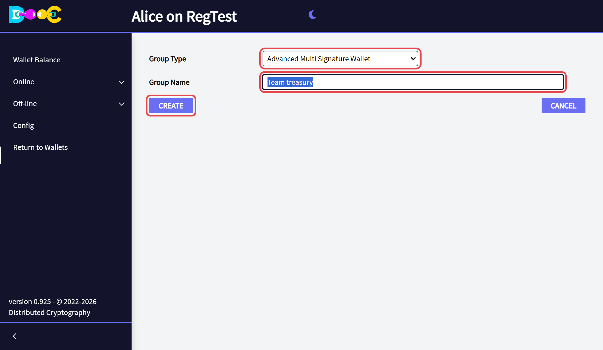

2. Click **Add a contact** for each signer. Type the **minimum** of signatures needed to pay (at least 2; you count
   as one of the signers) and click **Send invitation to group members**.

   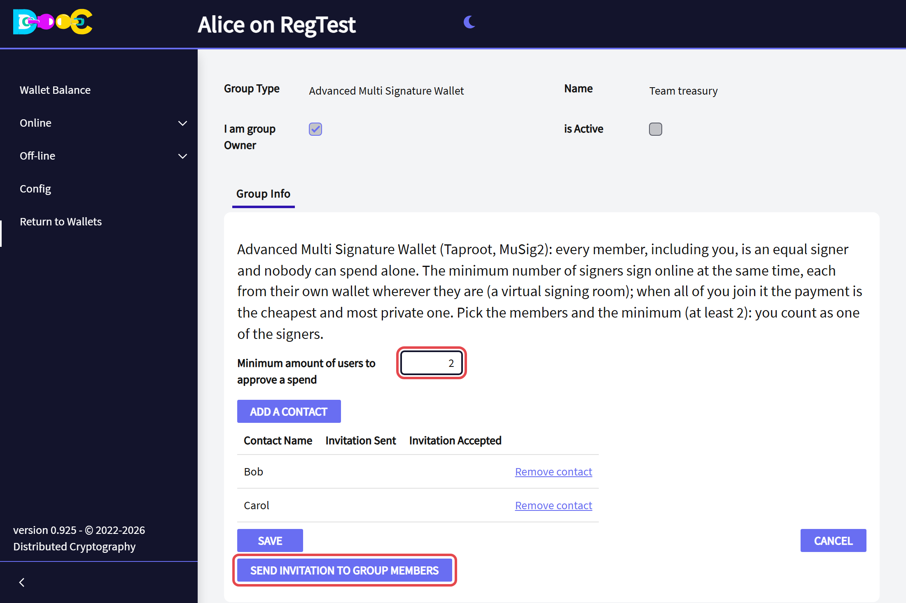

</Steps>

## 2. Accept the invitation (each signer)

Each signer opens **Online → Smart Groups** in their own wallet and clicks **Accept Invitation**.

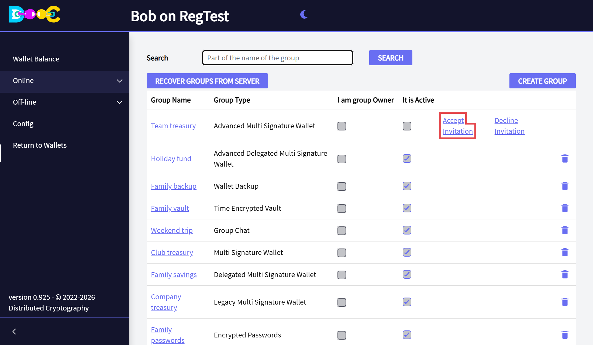

## 3. Activate the group (creator)

When every signer has accepted, open the group and click **Activate Group**, then type your password.

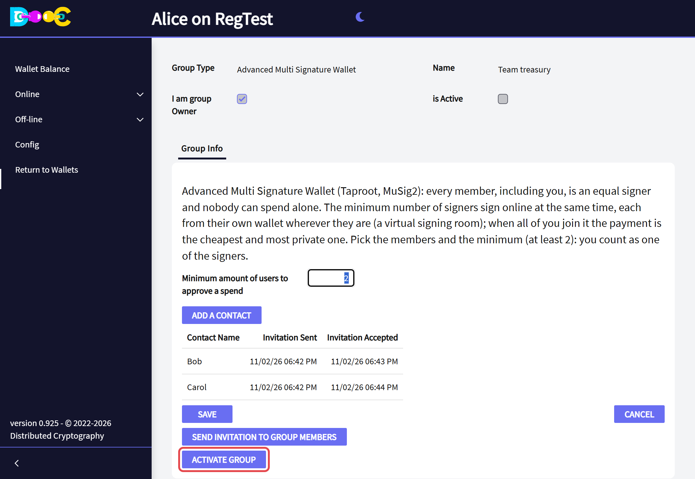

## 4. Receive

The **Wallet Balance** tab shows the next receiving address and its QR, the balance and the **Descriptors**.
**Rescan Balance** looks up every address of the group again.

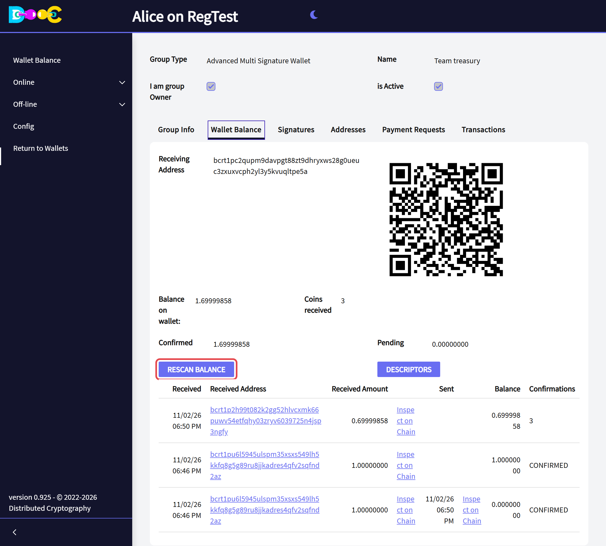

## 5. Pay: the signing room

Every payment is made in the group's **Signatures** tab. Each signer does these steps **in their own wallet**; the
app keeps everybody's screen up to date by itself. In the pictures all three signers join, so the payment goes by
the key path.

<Steps>

1. **Open a payment session** (any signer). In **Signatures** click **New payment**, type the amount, the
   destination and a description, and click **Open payment session**. Every member receives it and the session
   waits **15 minutes** for the signers. The one who opens it needs the group's balance in his wallet: click
   **Rescan Balance** in **Wallet Balance** first.

   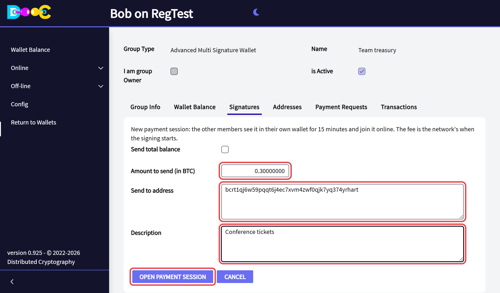

2. **Join it** (the other signers). Open the group's **Signatures** tab, check the payment and click **I'm here**.
   Below the list of sessions you see who has joined (*Joined (online now)*), who has not yet, and the chat of the
   session.

   A member who is not one of your contacts shows as the beginning of their user name (for example
   `bcrt1pmwfqjj4x...`), never with the name somebody else gave them: see
   [What the members see of each other](/groups/#what-the-members-see-of-each-other).

   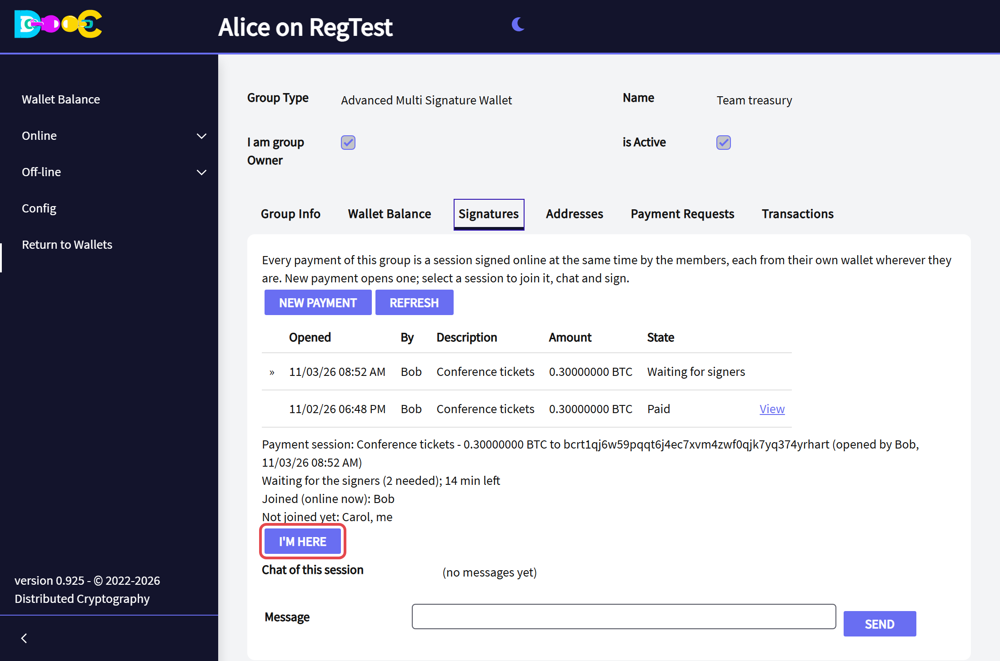

3. **Start signing** (the one who opened it). When at least the minimum has joined, click **Start signing**: it
   fixes who signs, the coins and the network's fee of that moment. If every signer of the group has joined, the
   payment uses the key path.

   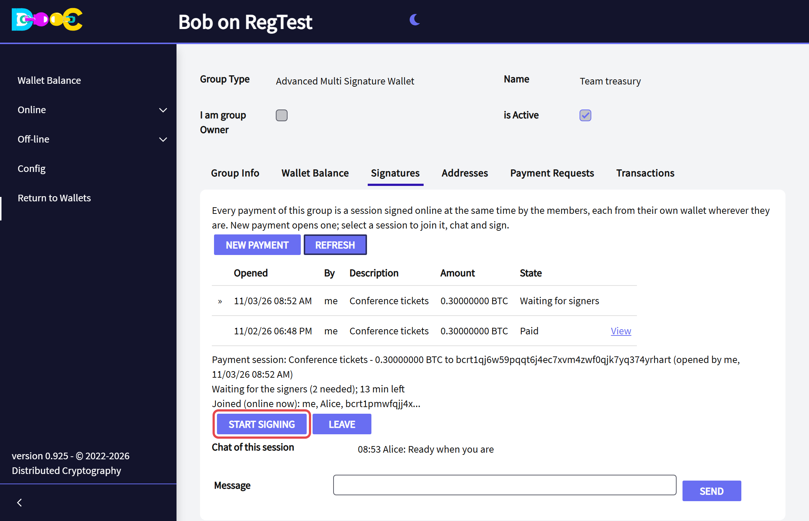

4. **Sign with password** (each signer). Click **Sign with password**, type your password and click **Sign**,
   within **3 minutes**. Until the last signature each signer sees *Signature sent*.

   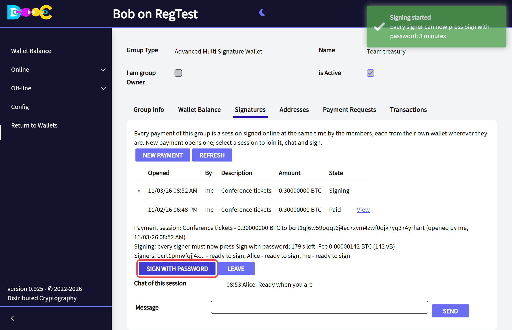

   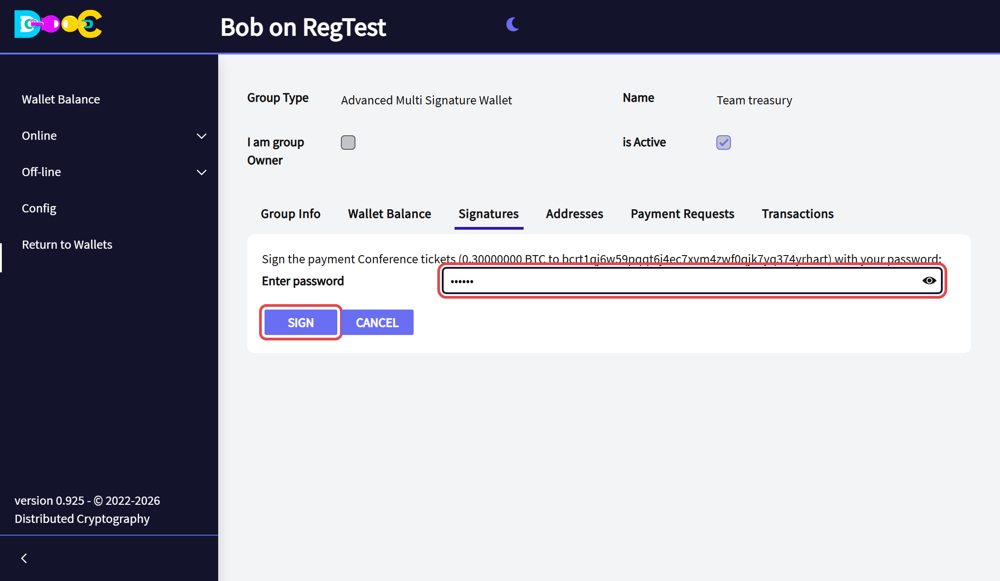

   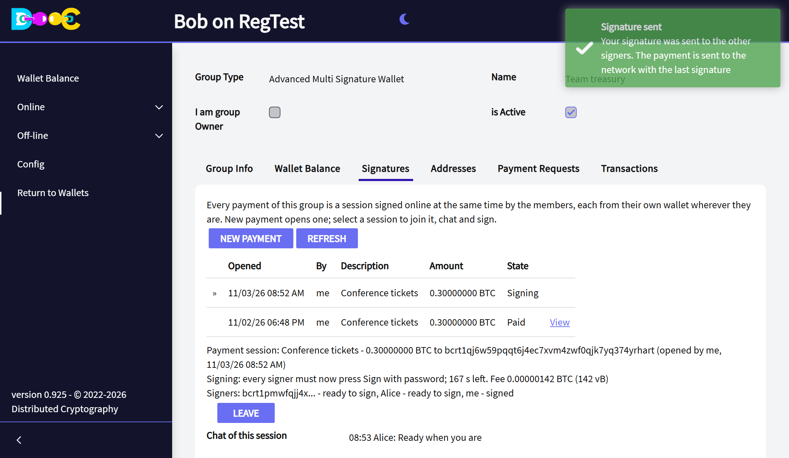

5. **Transaction broadcast.** The last signature completes the payment and sends it to the network, and the session
   shows *Paid* for everybody.

   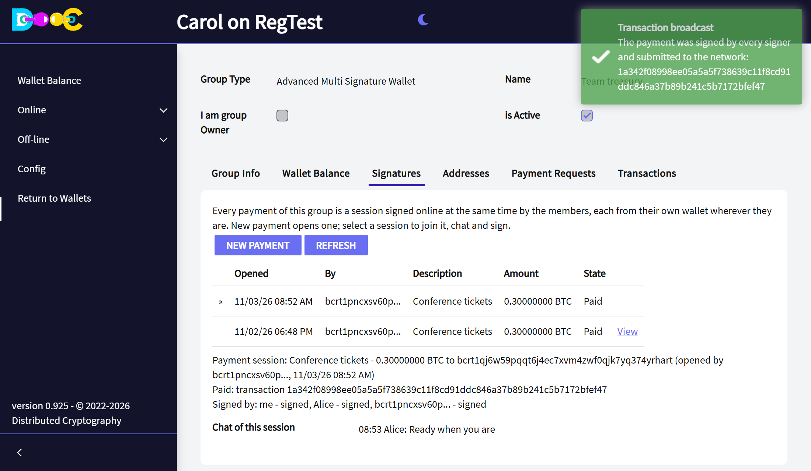

   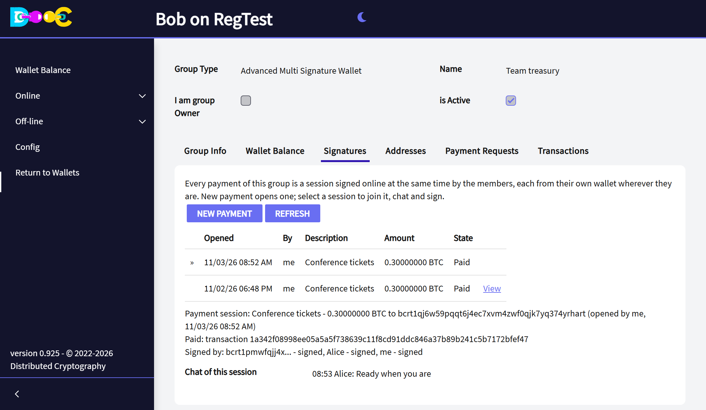

</Steps>

Anybody in the session can click **Leave**: it closes for everybody and its nonces are wiped. A session whose time
runs out closes by itself.

## 6. See the group in another wallet (descriptors)

In **Wallet Balance** click **Descriptors**:

```
tr(musig(xpubA/*,xpubB/*,xpubC/*),{pk(musig(xpubA/*,xpubB/*)),pk(musig(xpubA/*,xpubC/*)),...})
```

`musig()` is the BIP390 way to write a MuSig2 key: the first one is the internal key (all the signers), the others
are the scripts of K signers. Bitcoin Core 30 and later derive every address of the group from them.

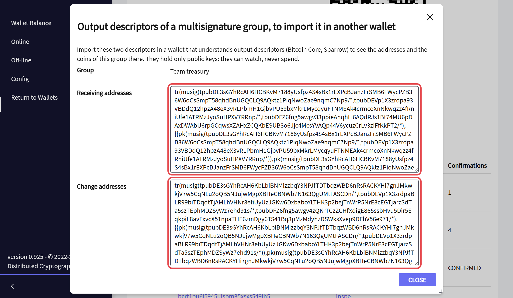

## Good to know

- **Online, not in person.** Each signer signs from their own wallet, anywhere in the world; what they share is the
  time. If the signers are rarely online together, use the [Multi Signature Wallet](/groups/multi-signature/),
  which is signed one after the other.
- **Nothing secret travels.** A session only carries the payment, the public nonces and the partial signatures,
  encrypted for each member.
- **Back up your own wallet** as usual: your keys of the group come from it.

## Related

- [What is a Smart Group?](/groups/)
- [Advanced Delegated Multi Signature Wallet](/groups/advanced-delegated-multisignature/)
- [Multi Signature Wallet](/groups/multi-signature/)
- [Bitcoin multisignature: a practical guide](/guides/multisig/)
