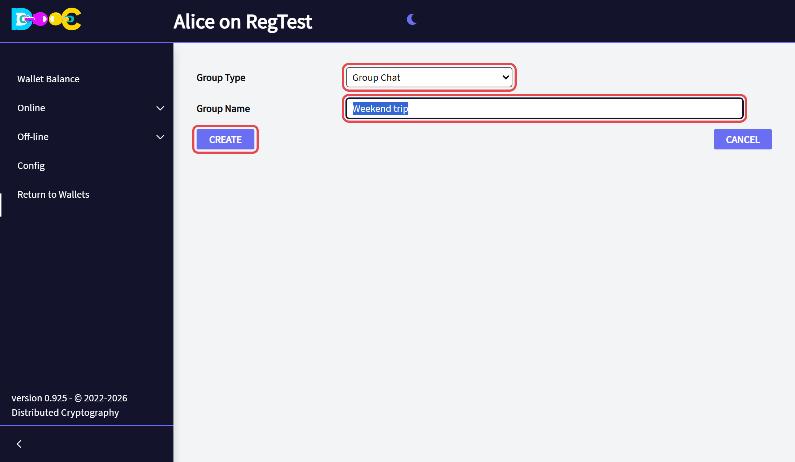
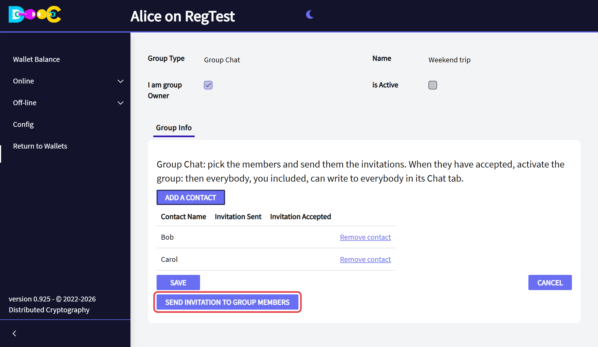
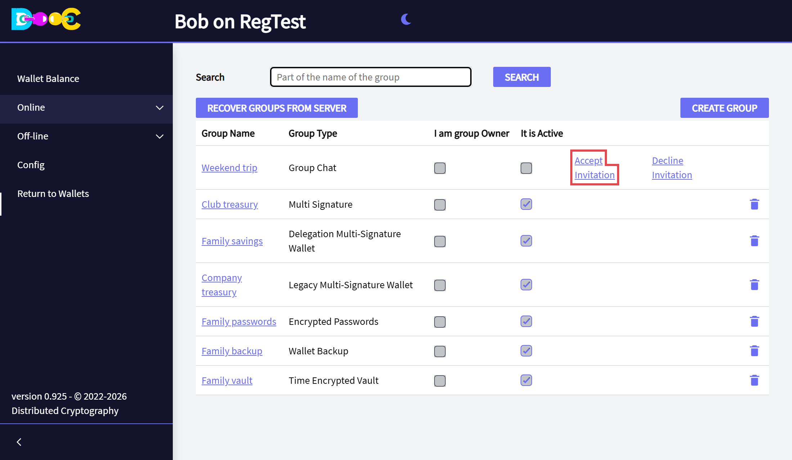
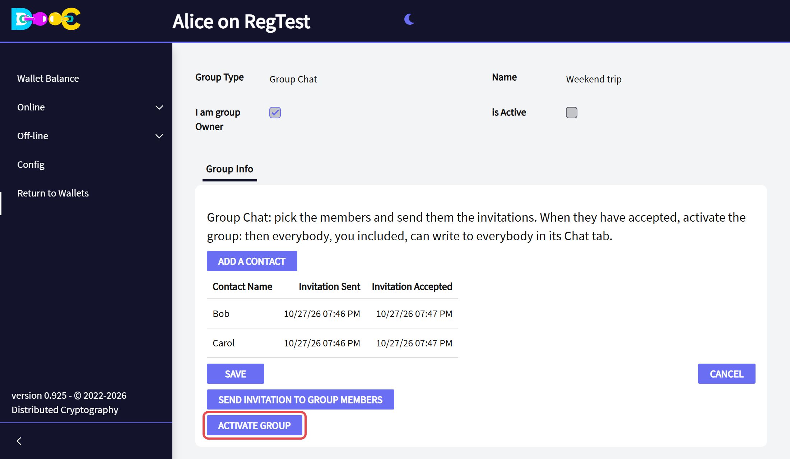
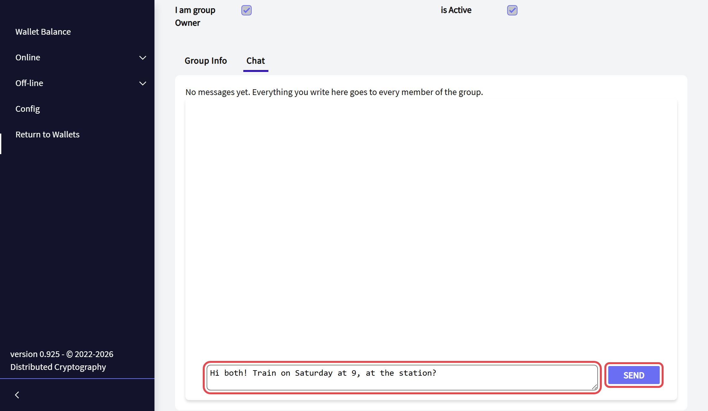
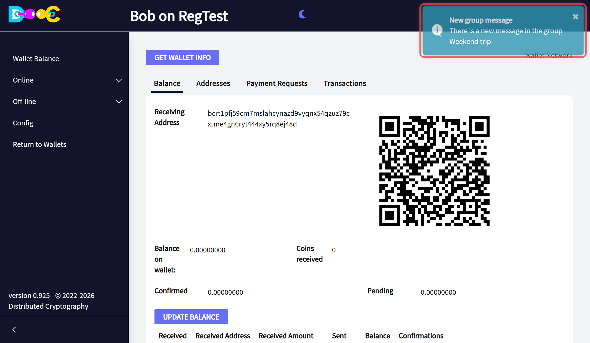
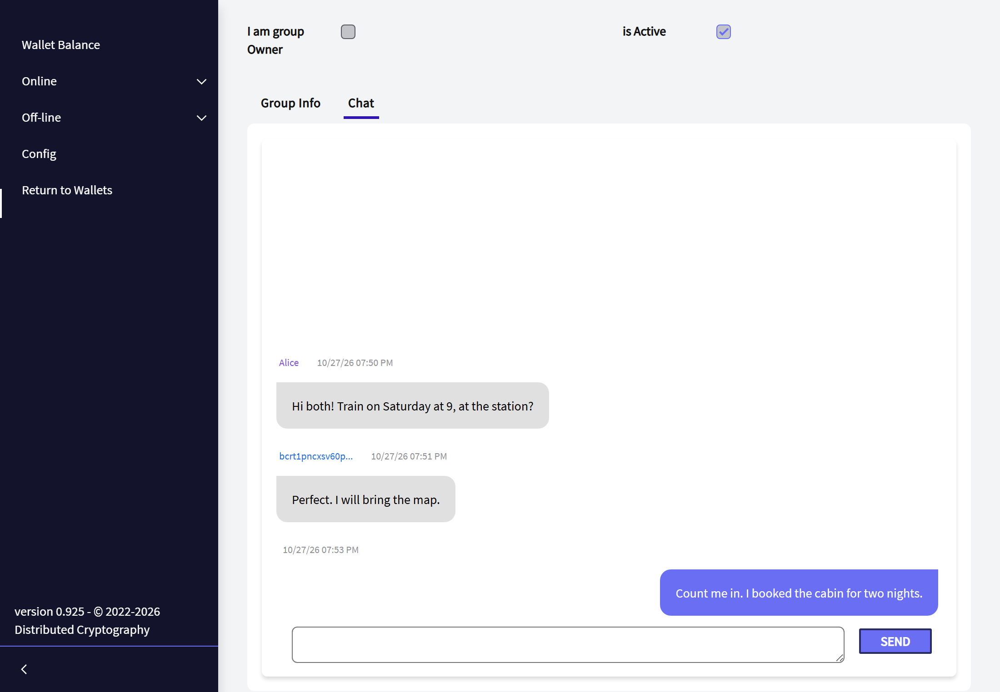

import { Steps } from '@astrojs/starlight/components';

:::tip[Next release]
Group Chat is part of the next release of Distributed Cryptography. It is not in the version you can download today.
:::

A Group Chat is a conversation of several people: everything a member writes reaches every other member. Like the
[one-to-one chat](/online/chat/), only the members can read it.

| | |
|---|---|
| Who writes | Every member, the creator included |
| Who reads | Only the members of the group |
| Members | The people you invite. They do not have to be contacts of each other, only yours |
| Messages | Encrypted for each member and signed by the person who wrote them |

## Before you start

- You are [logged in](/online/).
- Every person you want in the group is an **accepted** [contact](/online/contacts/) of yours.

## 1. Create the group and invite the members (creator)

<Steps>

1. Open **Online → Smart Groups** and click **Create Group**. Choose the type **Group Chat**, type a name and click
   **Create**.

   

2. Open the group. Click **Add a contact** for each person, then **Send invitation to group members**.

   

</Steps>

## 2. Accept the invitation (each member)

Each invited person opens **Online → Smart Groups**, finds the group and clicks **Accept Invitation**.

## 3. Activate the group (creator)

When everybody has accepted, open the group and click **Activate Group**. The wallet sends every member the list of
the members, so that each one can write to all the others. From now on the members of the group do not change.

## 4. Chat

<Steps>

1. Open the group: it opens on its **Chat** tab. Type your message and click **Send**. It goes to every member.

   

2. A member who is on another page gets a [notice](/online/notifications/). Click it to open the group. A member
   whose wallet was closed gets the messages, and their notices, the next time he opens it.

   

3. A member who has the Chat tab open sees the new messages at once, without reloading. Your messages are on the
   right; the messages of the others are on the left, each one with the name of its author **in his own colour**
   (the name you gave that contact; for a member who is not your contact, only the beginning of their user name,
   see [What the members see of each other](/groups/#what-the-members-see-of-each-other)). Every member keeps the
   same colour for everybody.

   

</Steps>

## How it is protected

- **Only the members read it.** Each message is encrypted separately for each member, with that member's group key.
  The servers that carry it see only encrypted data.
- **Nobody can write in the name of a member.** Each message is signed by its author. A member's wallet shows a
  message only if it comes from a member of the group and its signature is right; a copy of a message already
  received is ignored.
- The conversation is stored **inside each member's wallet**, encrypted like the rest of its files.

## Related

- [What is a Smart Group?](/groups/)
- [Chat](/online/chat/)
- [Notifications](/online/notifications/)
