import { Steps } from '@astrojs/starlight/components';

The Legacy Multi Signature Wallet is the **classic bitcoin multisignature wallet**: any K of the N members can sign a
payment together. Every member is an equal signer, the owner included. In the app the group type is called
**Legacy Multi-Signature Wallet**.

Use it when **nobody should be able to pay alone**, or when you need a multisignature wallet that follows the
long-established standards, for example to work with other software or with existing procedures.
[Delegated Multi Signature Wallet](/groups/delegated-multisignature/) costs less in fees and shows less on the
blockchain, but there the owner can always pay alone.

| | |
|---|---|
| Addresses | SegWit P2SH-P2WSH (they start with `3`; with `2` on the test networks) |
| Members | Up to 16, the owner included. K can be anything from 1 to all of them |
| Keys | [BIP48](https://github.com/bitcoin/bips/blob/master/bip-0048.mediawiki), from each member's own wallet, sorted as in [BIP67](https://github.com/bitcoin/bips/blob/master/bip-0067.mediawiki) |
| Descriptor | `sh(wsh(sortedmulti(K, ...)))`, shown by the app so other wallets can import the group |
| Signing | [PSBT (BIP174)](https://github.com/bitcoin/bips/blob/master/bip-0174.mediawiki) |

In this guide **Alice**, **Bob** and **Carol** share the wallet *Company treasury*. Any **two of the three** can
approve a payment.

## Before you start

- You are [logged in](/online/).
- Every person you want in the group is an **accepted** [contact](/online/contacts/).

## 1. Create the group and invite the members (owner)

<Steps>

1. Open **Online → Smart Groups** and click **Create Group**. Choose the type
   **Legacy Multi-Signature Wallet**, type a name and click **Create**.

   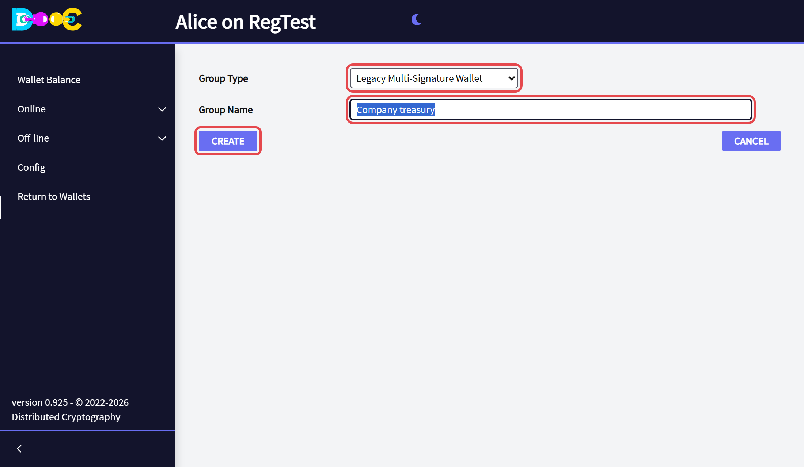

2. Open the group. Click **Add a contact** for each member. Set the
   **minimum amount of users to approve a spend**: this is the K of "K of N". You count as one of the N.

   Then click **Send invitation to group members**.

   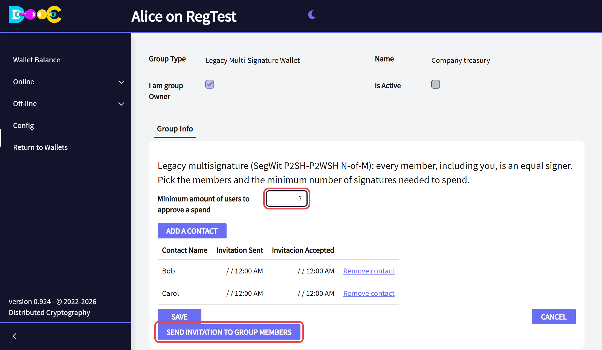

</Steps>

## 2. Accept the invitation (each member)

Open **Online → Smart Groups** in your own wallet and click **Accept Invitation** on the group's row.

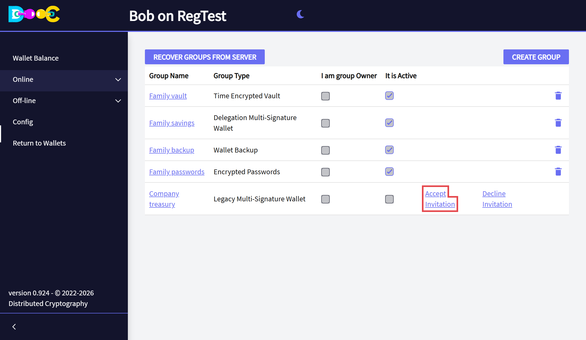

On accepting, your wallet sends the owner the public keys the group needs. No private key ever leaves a member's
wallet.

## 3. Activate the group (owner)

When every member has accepted, open the group and click **Activate Group**.

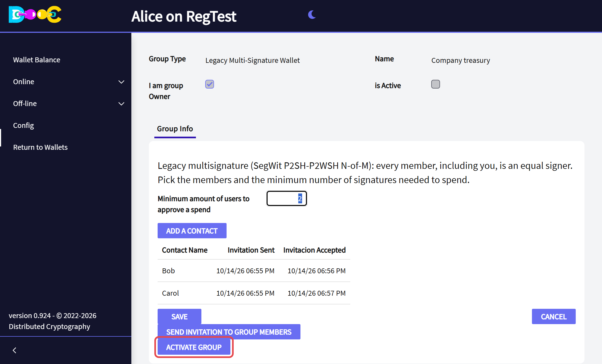

The group now has two more tabs: **Wallet Balance** and **Signatures**.

## 4. Receive

Open the group's **Wallet Balance** tab. It shows the **receiving address** of the group, as text and as a QR
code. Give it to whoever pays the group.

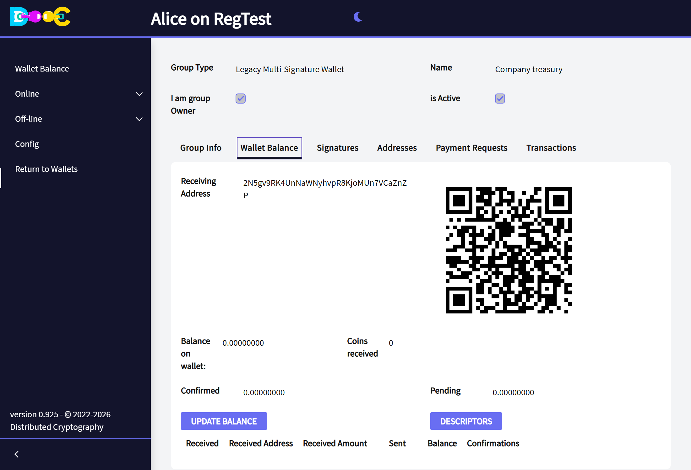

After a payment, click **Rescan Balance**. The page shows the balance and one line per payment, and the group
moves to a new receiving address.

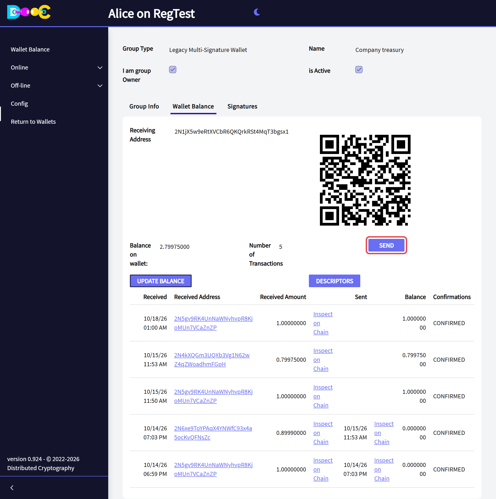

Every member sees the same wallet in their own *Wallet Balance* tab.

## 5. Start a payment (the first signer)

Any member can start a payment.

<Steps>

1. In the **Wallet Balance** tab click **Send**.

2. Type the **amount**, the **address** to pay and a **description**. The description is what the other members
   will see, so say what the payment is for. Click **Next**.

   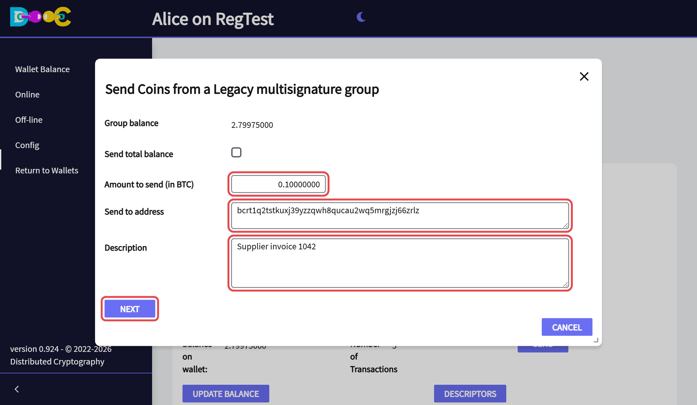

3. Choose the **fee**: one of the estimated levels in *Select Fee*, or tick *Manually select Fee* and type your
   own. This is the **calculated fee**.

4. Optional: tick up to **three extra fee options**. Each one is a percentage **above** the calculated fee:
   *+10%*, *+20%* and so on up to *+100%*.

   The members may sign hours or days apart, and by the time the last one signs the network may ask for a
   higher fee. With these options the last signer can pay more without starting again. You and every following
   signer sign all the options; only one is ever sent.

   Click **Send Coins**.

   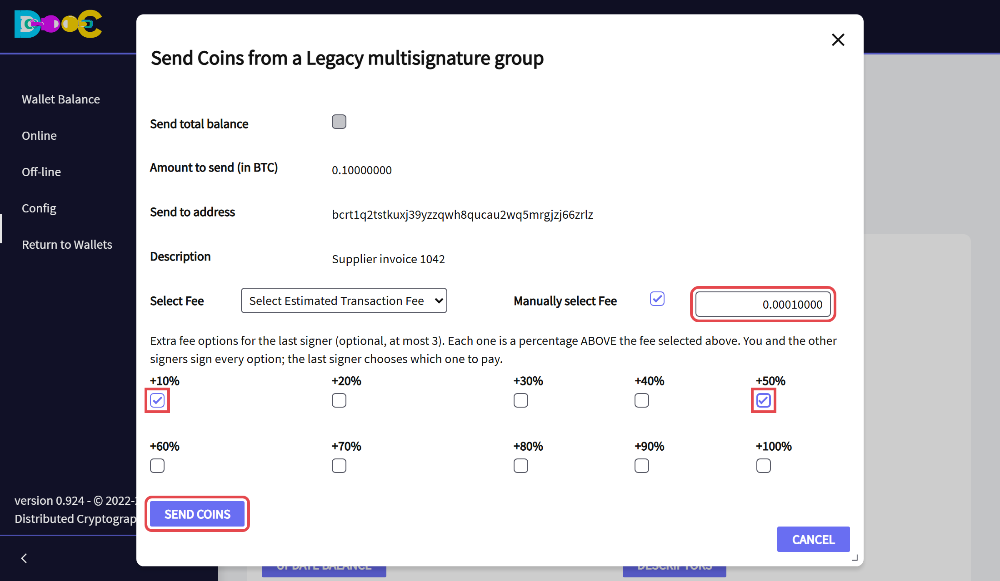

5. Type your **wallet password** and click **Confirm**. Your signature is made now.

   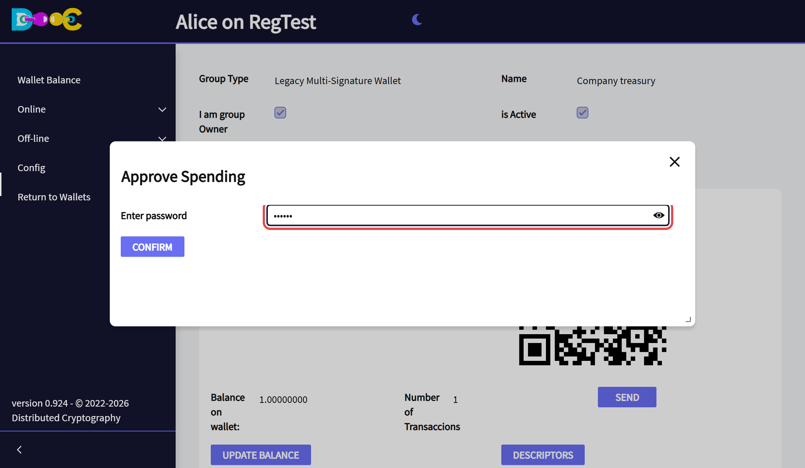

6. The app shows **Signature added: your signature was added and forwarded to the other signers**. Nothing has
   been sent to the bitcoin network yet: the payment waits for the other signatures.

</Steps>

The payment is now in the **Signatures** tab, with your signature and *Fully signed* still empty:

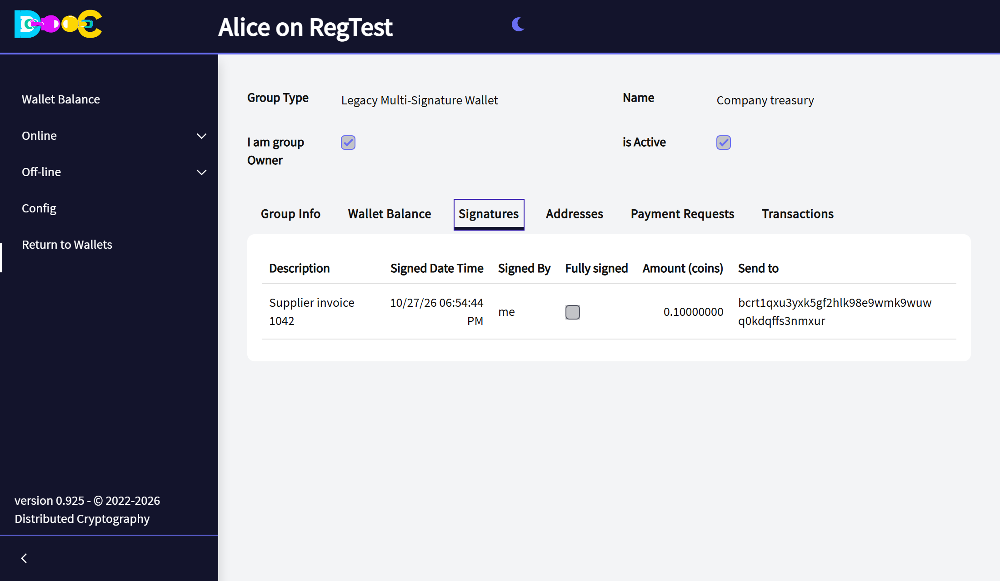

If the minimum of the group is **1**, there is nothing to wait for: you see no extra options, and your own
signature sends the payment.

A payment can use coins of several addresses of the group (the group moves to a new receiving address after each
payment it receives, and the change of a payment goes to a change address of the group): every member signs each
coin with the right key.

## 6. Sign the payment (each following signer)

<Steps>

1. Open your wallet, open the group and go to the **Signatures** tab. The payment is there with its description,
   who signed it, the amount and the address. Click **Sign transaction**.

   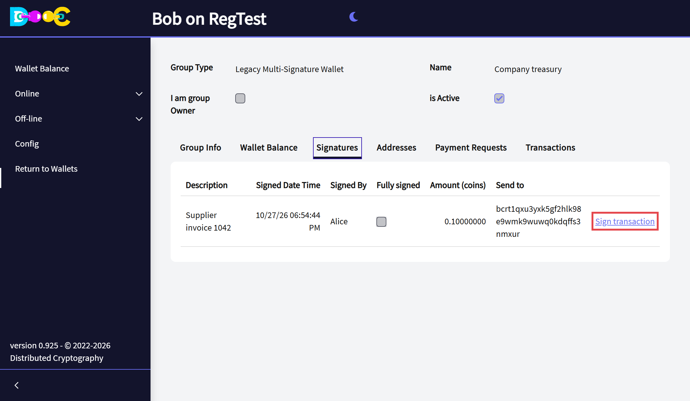

2. **Check the payment**: amount, address, description and fee. They cannot be changed. If it is what you agreed
   to, click **Next**.

   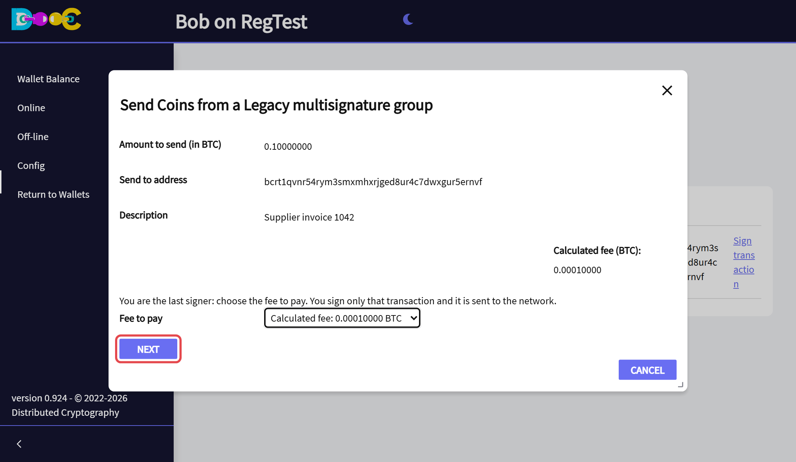

3. What happens next depends on how many signatures are still missing:

   - **More signatures are needed after yours.** The window lists the fee options the first signer set. You
     choose nothing: click **Send Coins**.
   - **Yours is the last signature.** Choose the **Fee to pay**: the calculated fee, or one of the higher
     options if the network is busy. Click **Send Coins**. You sign only that transaction.

   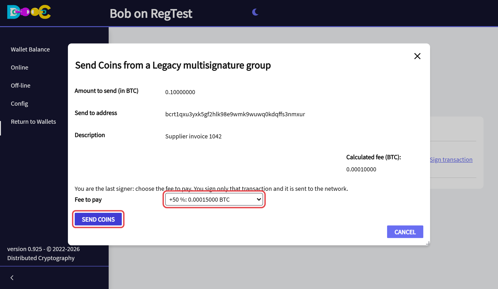

4. Type your **wallet password** and click **Confirm**. Your signature is made now: the payment goes on to the
   next signer, or, if yours was the last one, it is sent to the bitcoin network.

</Steps>

When the **last needed signature** is added, the app shows **Transaction broadcast**: the payment has been sent
to the bitcoin network with the fee the last signer chose. The *Signatures* tab shows it as *Fully signed*.

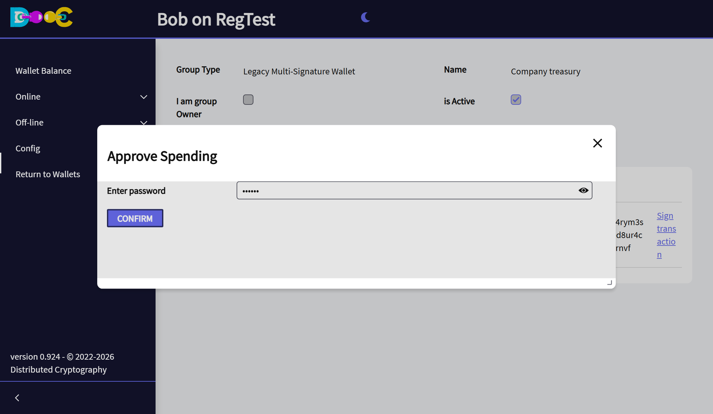

If more signatures are still needed (a 3-of-5 group, for example), your signature is added and the payment goes
on to the next signer in the same way.

The balance follows the payment by itself: the payment shows up at once as *Sent* with its fee,
the change is already in the balance, and every member sees it the next time they open the group, with its
confirmations going up. Opening a group with a payment on its way takes a few seconds more, because the app reads
its balance first.

The *Wallet Balance* tab shows the new balance of the group:

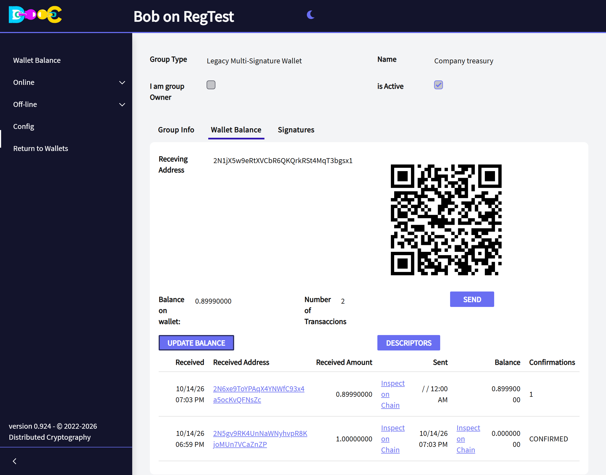

## 7. See the group in another wallet (descriptors)

A **descriptor** is a standard text that describes all the addresses of a wallet. With the two descriptors of the
group, any wallet that understands descriptors (Bitcoin Core or Sparrow, for example) shows the same addresses
and the same coins, **without our software**.

<Steps>

1. In the **Wallet Balance** tab click **Descriptors**.

   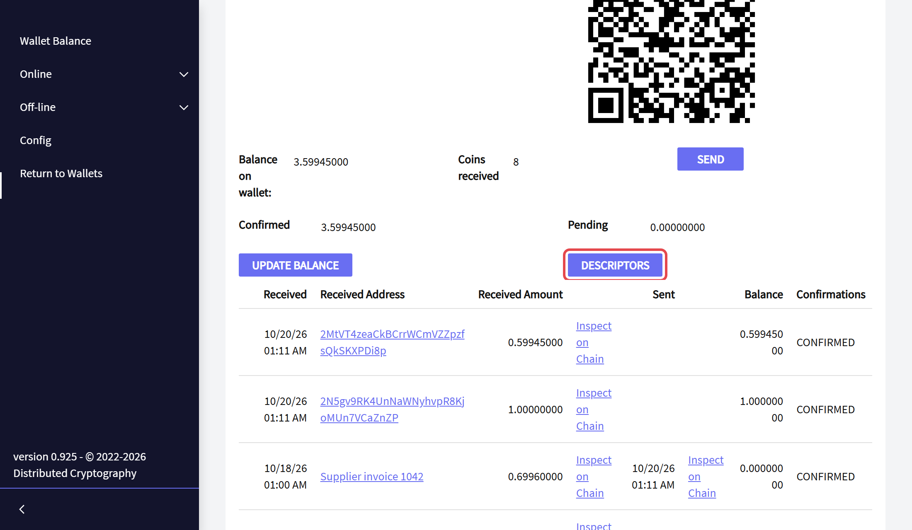

2. Copy the two texts: one for the **receiving addresses**, one for the **change addresses**.

   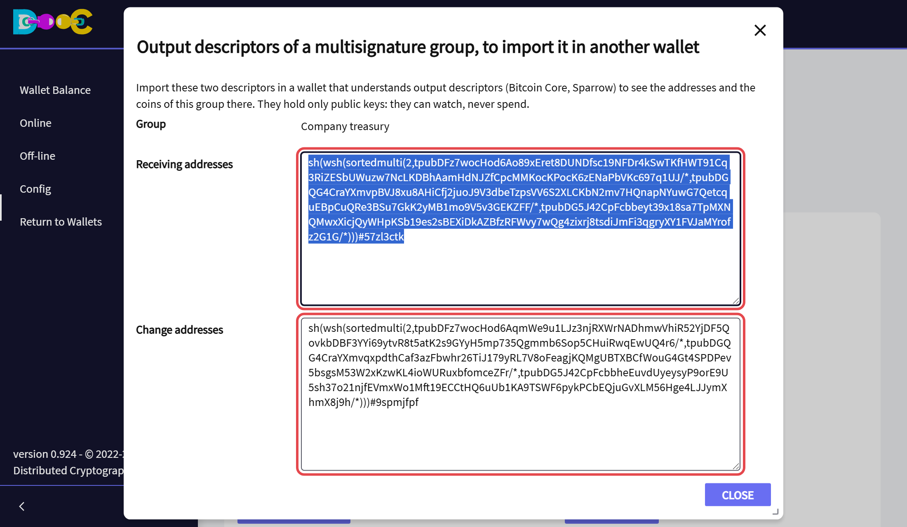

3. Import them in the other wallet. In Bitcoin Core, in a wallet created without private keys:

   ```
   importdescriptors '[{"desc":"<receiving descriptor>","timestamp":"now","range":[0,100],"active":true,"internal":false},{"desc":"<change descriptor>","timestamp":"now","range":[0,100],"active":true,"internal":true}]'
   ```

</Steps>

The descriptors hold only **public keys**: whoever has them can watch the group, never spend from it. They do
show every address of the group, so share them only with people who may see its balance.

## A member with a Ruby wallet

A [Ruby wallet](/wallet/ruby/) is a member like any other, and **it signs on Ruby**: no password is asked and no
private key reaches the computer. Ruby shows each transaction and you approve it there.

- **Joining** asks nothing on Ruby: accept the invitation as in [step 2](#2-accept-the-invitation-each-member). The
  group needs only public keys, which Ruby gave the wallet when it was opened.
- **Signing**, as the first signer or a following one: the steps are the same as above, but the button says
  **Send Coins (confirm on Ruby)** and, instead of the password, you approve on Ruby.

### The first time: register the group on Ruby

The first time Ruby signs for a group, it asks to **register** it. It is done once per group and Ruby. Registered,
Ruby knows every key of the group: it checks that the coins spent belong to the group and recognises the change,
which it then does not show.

| | |
|---|---|
| 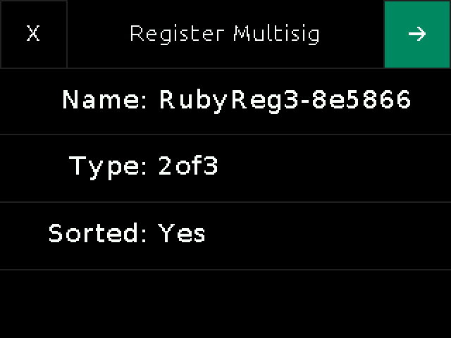 | **Register Multisig**: the name of the group on Ruby (the start of the group name and a code made from its keys), the minimum (**2of3**) and **Sorted: Yes**. **B**. |
| 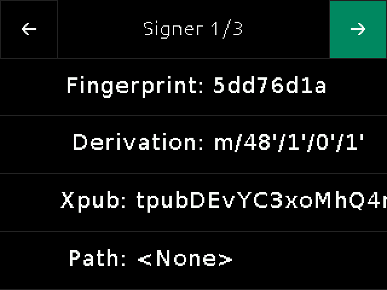 | **Signer 1/3 … 3/3**: the fingerprint, the path and the public key of each member. **B** for each one. |
| 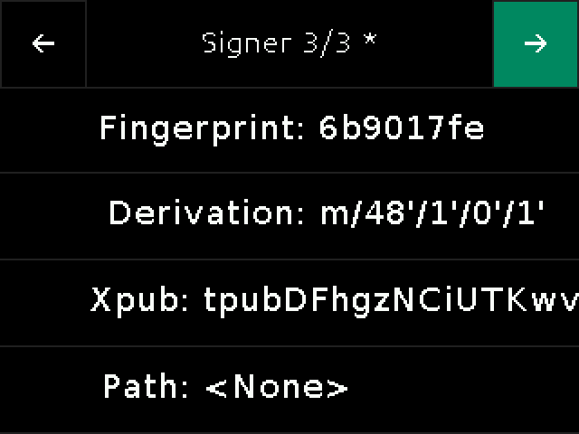 | The signer marked with **\*** is this Ruby. |
| 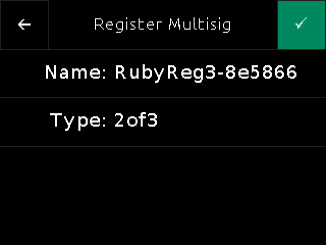 | **C** moves to ✓, **B** registers the group. |

### Approve the payment

| | |
|---|---|
| 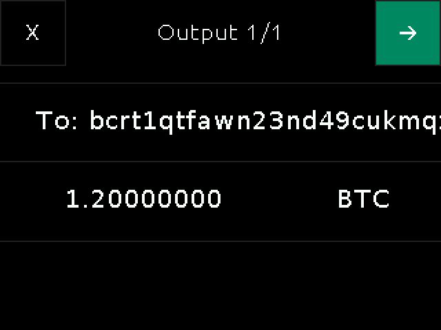 | **Output 1/1**: the address paid and the amount. The change, back to the group, is not shown. **B**. |
| 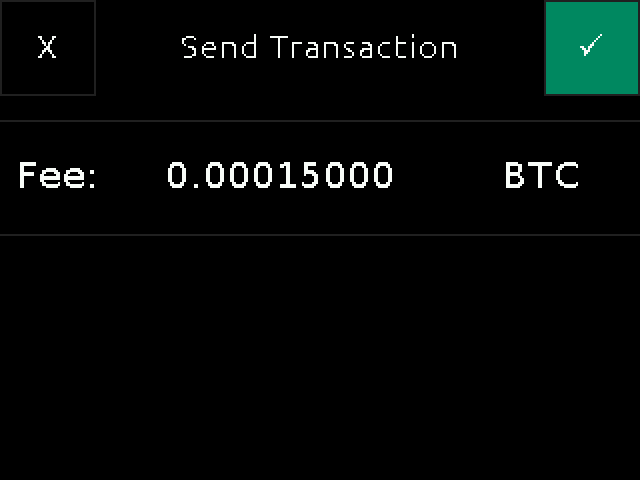 | **Send Transaction**: the fee you chose (when Ruby gives the last signature) or the calculated fee. **X** is selected first: **C** moves to ✓, **B** approves. |

**When Ruby starts a payment with extra fee options**, it signs one transaction per option, but asks only **once**:
the payment, and then one screen with every fee.

| | |
|---|---|
| 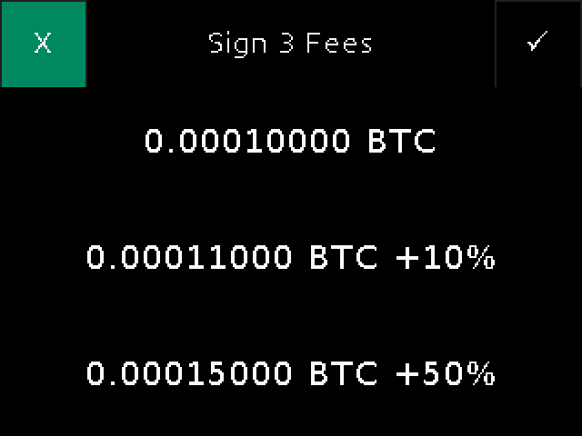 | **Sign 3 Fees**: the calculated fee and the options (+10 %, +50 %). |
| 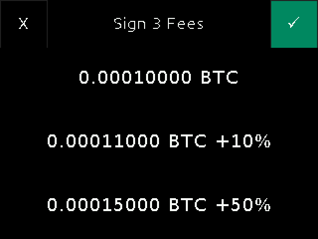 | **C** moves to ✓, **B** approves them all. Ruby signs the other options only if they spend the same coins and pay the same address and amount. |

To decline, go to **X** (**A**) and press **B** on any of those screens: the application says *The payment was
declined on Ruby*, and nothing is signed or sent.

## Good to know

- **Signers do not have to be connected at the same time.** A payment to sign arrives when the member opens
  their wallet. If it is not in the *Signatures* tab yet, go back to the wallets page and open the wallet again
  a little later.
- **Check before you sign.** Sign only what you agreed to.
- **Backups.** Each member's keys for the group come from their own wallet. A member who restores their wallet
  from their words, or through a [Consensus Backup](/groups/consensus-backup/), can sign again.
- **Do not lose too many members.** If fewer than the minimum can still sign, the money is locked. Choose N and
  K with that in mind: 2-of-3 survives the loss of one member, 3-of-5 the loss of two.
