import { Steps } from '@astrojs/starlight/components';

:::tip[Next release]
Multi Signature is part of the next release of Distributed Cryptography. It is not in the version you can
download today.
:::

With Multi Signature a group of people shares one bitcoin wallet and **every payment needs K of the N signatures**.
You create the group, but you are **one more signer**: you have no special power, and **nobody can pay alone** -
not you, not any member.

It fits money that belongs to several people at once: the treasury of a company, a club or an association, the
savings of a couple or a family, the reserve of a project.

| | |
|---|---|
| Addresses | Taproot (they start with `bc1p`; with `tb1p` or `bcrt1p` on the test networks) |
| Who can pay | K of the N signers together. You, the creator, are one of the N |
| Signers | Any number, as long as the group has at most 2000 combinations of K signers (for example 2 of 60, 3 of 23, 5 of 12, 10 of 12) |
| Keys | From each person's own wallet; no private key ever leaves it |
| Standards | [BIP341](https://github.com/bitcoin/bips/blob/master/bip-0341.mediawiki) Taproot, [BIP342](https://github.com/bitcoin/bips/blob/master/bip-0342.mediawiki) scripts, [BIP327](https://github.com/bitcoin/bips/blob/master/bip-0327.mediawiki) MuSig2 key aggregation, [BIP386](https://github.com/bitcoin/bips/blob/master/bip-0386.mediawiki) / [BIP387](https://github.com/bitcoin/bips/blob/master/bip-0387.mediawiki) / [BIP390](https://github.com/bitcoin/bips/blob/master/bip-0390.mediawiki) descriptors, [PSBT (BIP174)](https://github.com/bitcoin/bips/blob/master/bip-0174.mediawiki) |

## Which multisignature wallet?

| | Multi Signature | [Delegated Multisignature](/groups/delegated-multisignature/) | [Legacy Multisignature](/groups/legacy-multisignature/) |
|---|---|---|---|
| Can somebody pay alone? | **No**, nobody | Yes, the owner | No, nobody |
| The creator of the group | One more signer | The owner, who also pays alone | One more signer |
| Addresses | Taproot (`bc1p…`) | Taproot (`bc1p…`) | SegWit P2SH (`3…`) |
| What a payment shows | Only the keys of the K who signed | Only the keys of the K who signed (or nothing when the owner pays) | Every key of the group |
| Size of the payment | Small | Small | Larger: higher fees |
| Largest group | Up to 2000 combinations of K signers | Up to 2000 combinations of K members | 16 signers |

Multi Signature is the modern version of Legacy Multisignature: the same trust model, with the lower fees and the
better privacy of Taproot.

## How the address is built

A Taproot address has two ways to be spent:

- **The script path.** The group has one small script for every combination of K signers ("these K sign"). A
  payment reveals only the script of the K people who signed it: the other signers, and even the size of the group,
  stay hidden.
- **The key path.** One public key, the *internal key*, that could spend alone with a single signature. In a
  Delegated group it is the owner's key: that is why the owner pays alone.

In Multi Signature the internal key belongs to nobody. It is the **MuSig2 aggregate of the keys of all the N
signers** ([BIP327](https://github.com/bitcoin/bips/blob/master/bip-0327.mediawiki)).

### Why the MuSig2 aggregate of all the signers

We had three options for that key. This is the one we chose, and why:

1. **It is deterministic.** Anybody who has the N public keys computes the same key, and so the same address. The
   group can be described with a standard descriptor and rebuilt in another wallet. Nothing random has to be
   stored or shared.
2. **Nobody can sign with it alone.** A signature with the aggregate key needs **all N signers together**, in a
   live signing session (MuSig2). That is stricter than the K of N the group asks for, so it gives nobody a shortcut.
   Distributed Cryptography never uses it: every payment goes through the K-of-N scripts.
3. **It is not the plain sum of the keys.** Adding the N public keys together looks simpler, but it is unsafe: a
   member could choose his key as *"the key I want, minus the sum of the others"*. The sum would then be a key that
   only he knows, and he could empty the wallet **alone** (this is called a *rogue-key attack*). BIP327 multiplies
   every key by a coefficient that depends on all the keys, which makes this impossible.
4. **Why not a key that nobody can ever use** (a "NUMS" point, BIP341)? It would also block the key path, but
   forever. The aggregate keeps the door open to a future option: when **every** signer is online at the same time,
   the group could pay with one aggregated signature, the cheapest and most private payment Bitcoin has.

## Before you start

- You are [logged in](/online/).
- Every person you want in the group is an **accepted** [contact](/online/contacts/).

## 1. Create the group and invite the signers (creator)

<Steps>

1. Open **Online → Smart Groups** and click **Create Group**. Choose the type **Multi Signature**, type a name and
   click **Create**.

   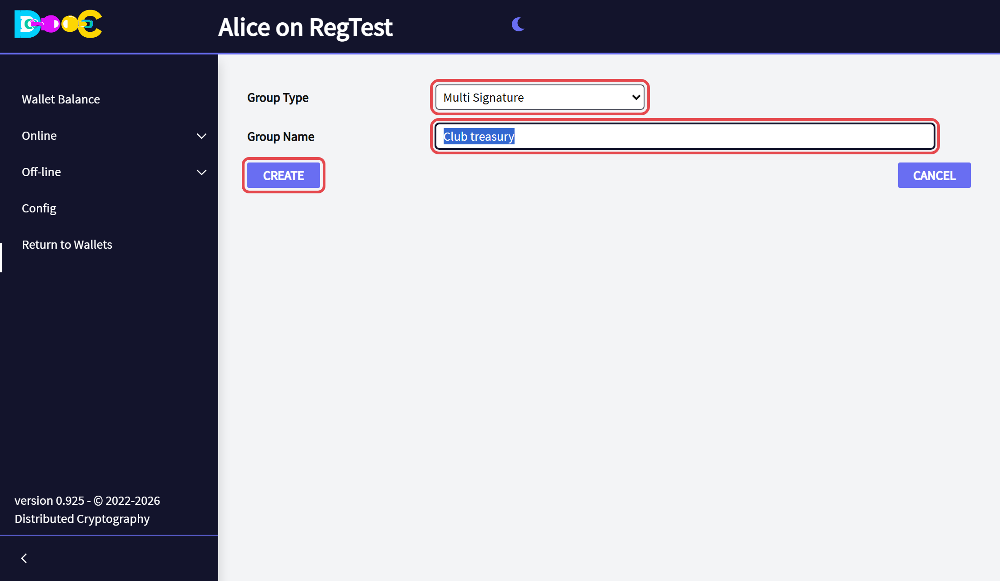

2. Open the group. Click **Add a contact** for each person. Set the **minimum amount of users to approve a
   spend**: this is the K of "K of N". **You count as one of the N**: with 2 contacts the group has 3 signers, and
   the minimum can be 1, 2 or 3.

   Then click **Send invitation to group members**.

   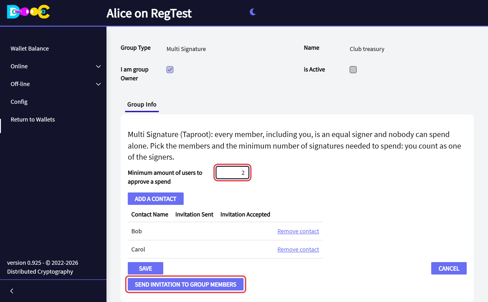

</Steps>

## 2. Accept the invitation (each signer)

Each invited person opens **Online → Smart Groups**, finds the group and clicks **Accept Invitation**. Their wallet
gives the group their public keys; no private key leaves it.

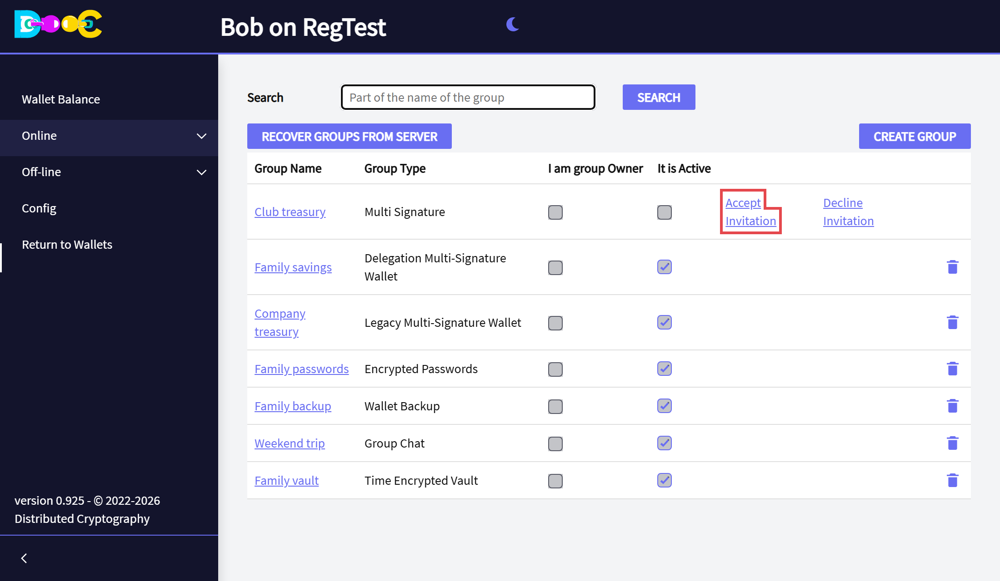

## 3. Activate the group (creator)

When everybody has accepted, open the group and click **Activate Group**. From now on the group has its addresses,
and nobody can change its members or its minimum.

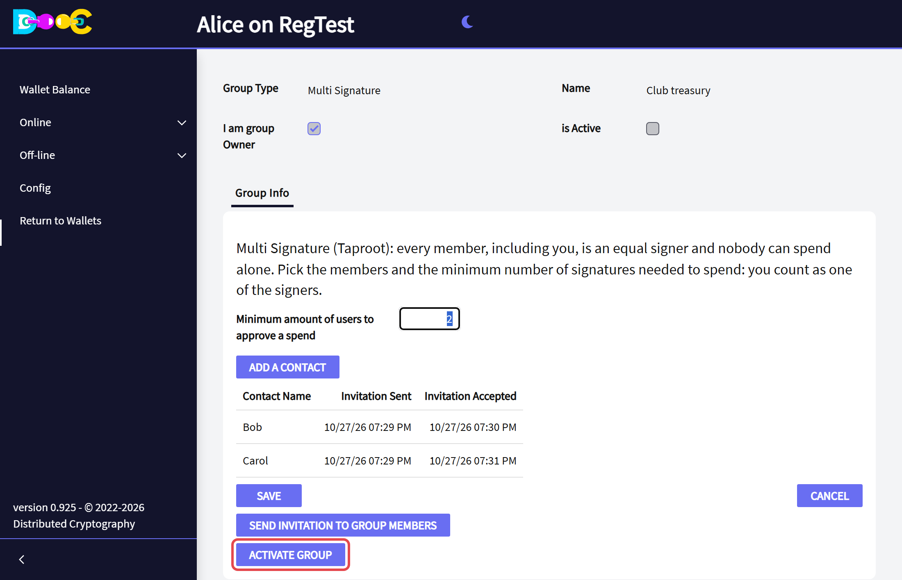

## 4. Receive

Open the group's **Wallet Balance** tab: it shows the next receiving address and its QR. Anybody can pay to it.
The tabs **Addresses**, **Payment Requests** and **Transactions** work like the ones of your own wallet.

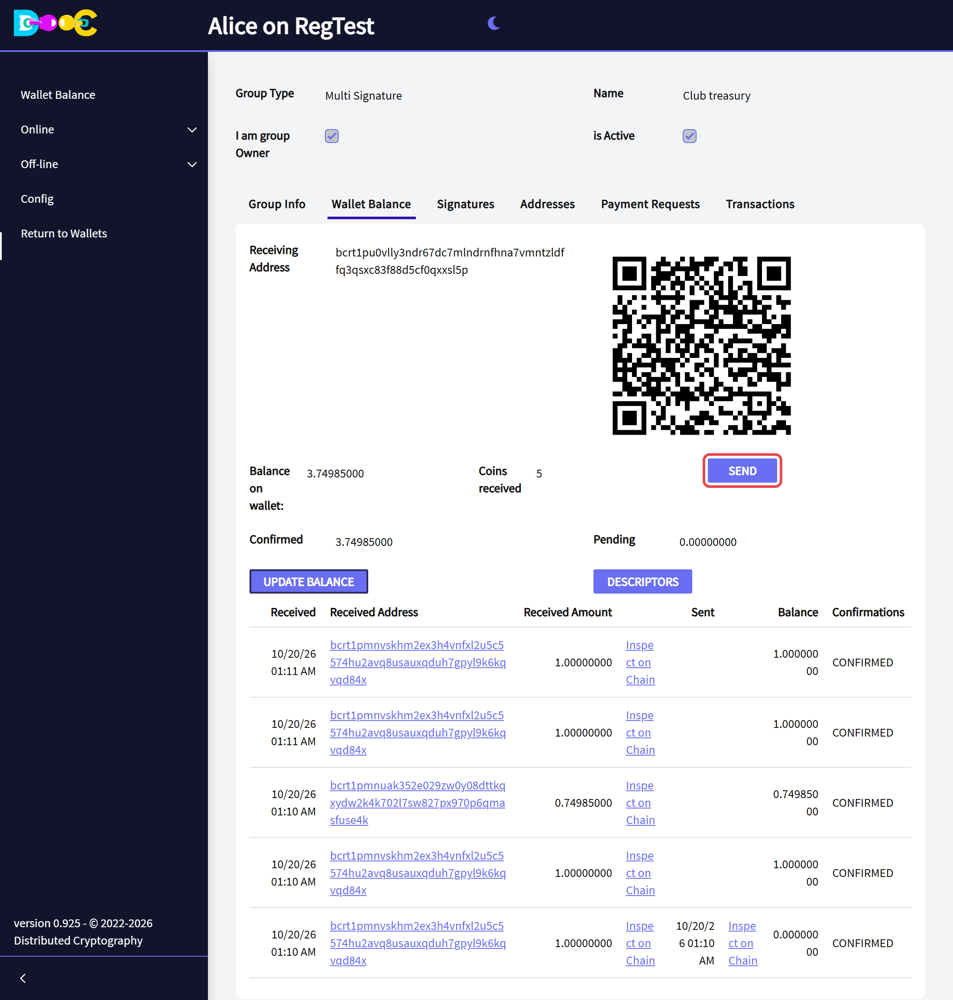

## 5. Start a payment (the first signer)

Any signer can start a payment - you, the creator, too.

<Steps>

1. In **Wallet Balance** click **Send**. Type the amount, the destination address and a description (it is
   mandatory in a group). Optionally click **Choose Coins** to pick which coins are spent.

   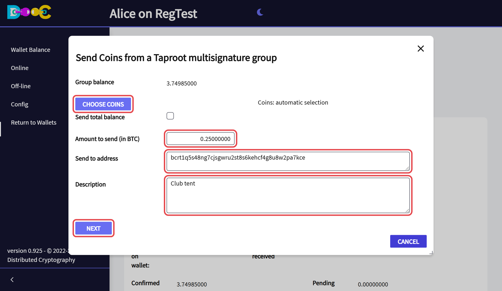

2. Click **Next** and choose the fee.

3. **Extra fee options for the last signer** (optional, at most 3): each one is a percentage **above** the fee you
   chose. You sign every option; the last signer will choose which one to pay. This lets the group react if the
   network becomes busy before the last signature arrives.

   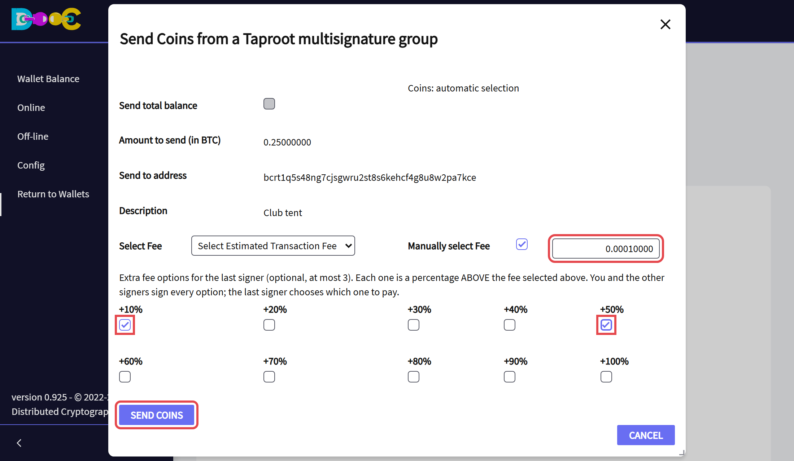

4. Click **Send Coins** and type your password. Your signature is added and sent to the other signers. With a
   minimum of 1 your signature is the only one needed and the payment is sent at once.

   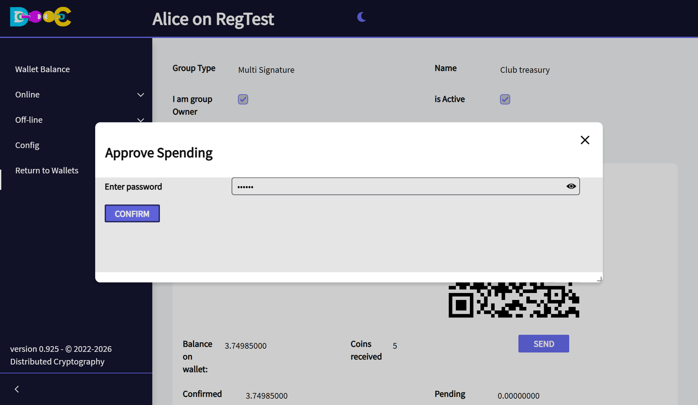

   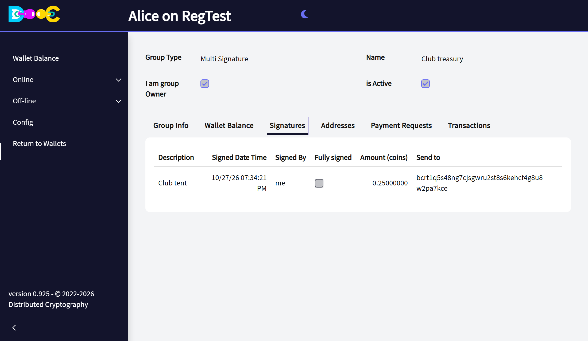

</Steps>

## 6. Sign the payment (the following signers)

The other signers find the payment in the group's **Signatures** tab and click **Sign transaction**. The amount and
the destination are read from the transaction itself and cannot be changed.

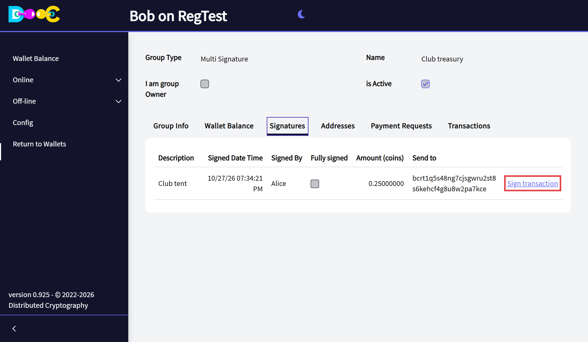

- A signer **in between** sees the fee options as text, types the password and signs.
- The **last signer** chooses the fee to pay (the calculated one or one of the options). He signs only that
  transaction and it is sent to the network.

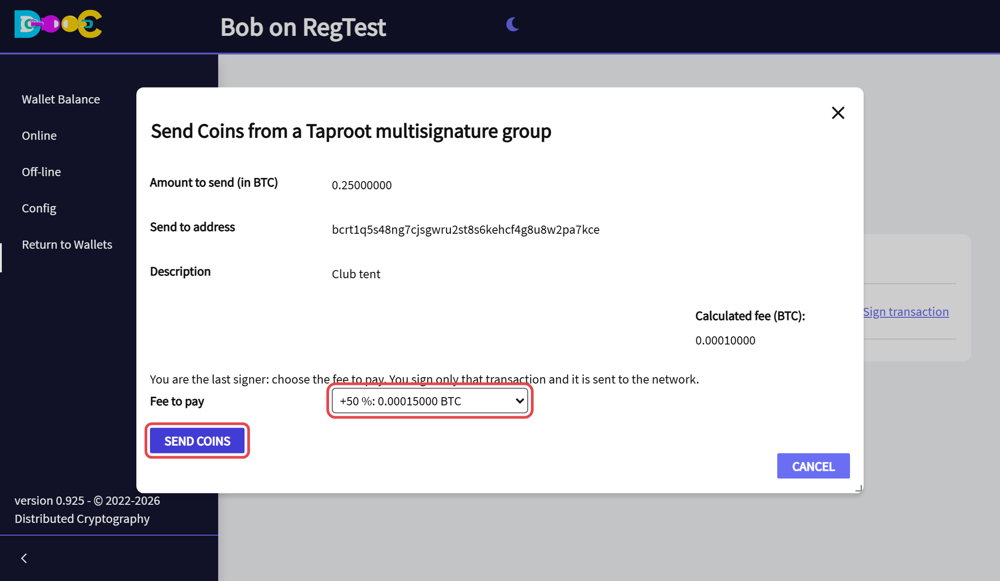

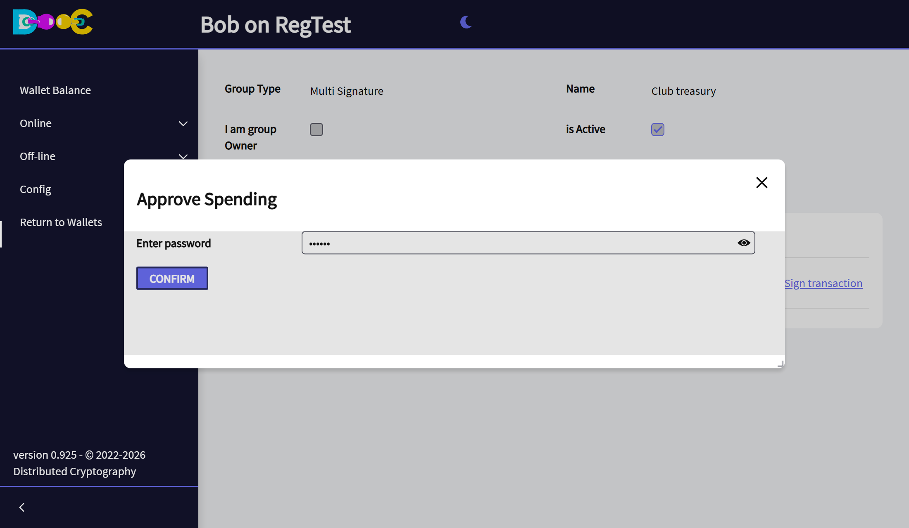

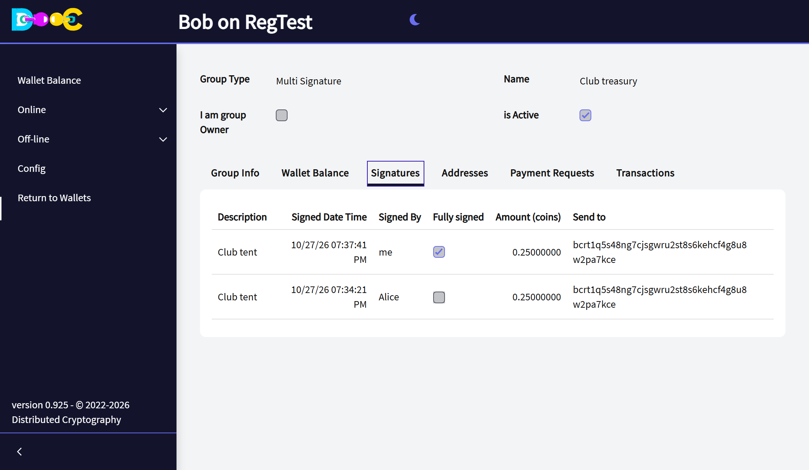

The balance follows the payment by itself: the payment shows up at once as *Sent* with its fee, the change is
already in the balance, and every signer sees it the next time they open the group, with its confirmations
going up. Opening a group with a payment on its way takes a few seconds more, because the app reads its
balance first.

## 7. See the group in another wallet (descriptors)

In **Wallet Balance** click **Descriptors**. The group is described by two standard descriptors, one for the
receiving addresses and one for the change:

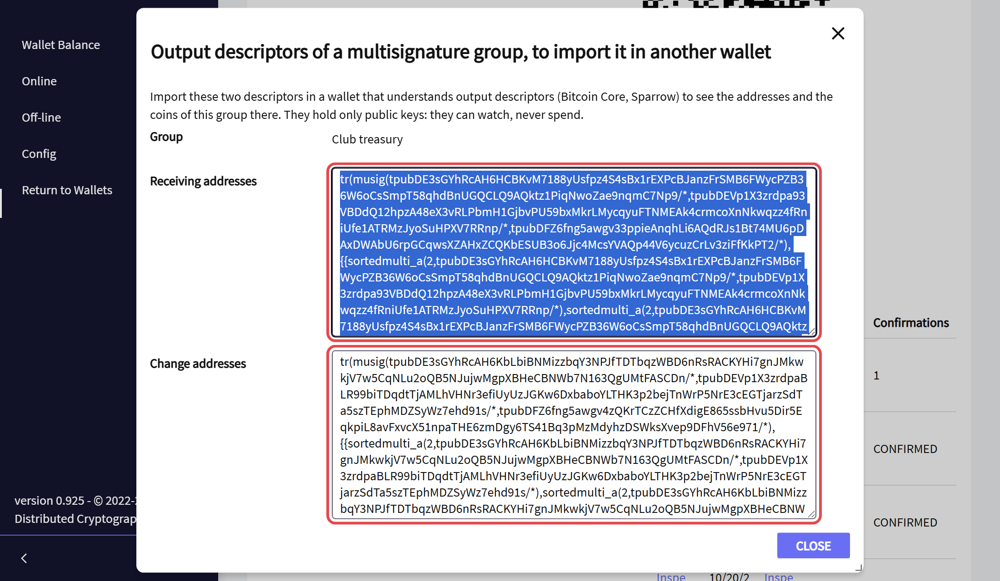

```
tr(musig(xpubA/*,xpubB/*,xpubC/*),{sortedmulti_a(2,xpubA/*,xpubB/*),...})
```

`musig()` is the BIP390 way to write the aggregate key. A descriptor wallet that supports it can watch the group
and rebuild every address without Distributed Cryptography.

## Good to know

- **The size of the group.** The address has one script for every combination of K signers, and every signer signs
  each combination he is part of. That is why a group can have at most 2000 combinations: 2 of 60 or 59 of 60 are
  fine, 6 of 14 is not (3003 combinations). Very large groups with a K in the middle (15 of 50 would need more than
  two trillion combinations) are impossible with any wallet of this kind.
- **A minimum of 1** means that any single signer can pay alone. Choose it only if that is what the group wants.
- **Back up your own wallet** as usual: your keys of the group come from it.
- **The BLAKE2b fork (BTCB2).** That chain enforces BIP-110, which would limit a group to 128 combinations of K
  signers. On Bitcoin nothing changes. See [BIP-110 and multisignature groups](/reference/bip110-multisignature/).

## Related

- [What is a Smart Group?](/groups/)
- [Delegated Multisignature](/groups/delegated-multisignature/)
- [Legacy Multisignature](/groups/legacy-multisignature/)
- [Bitcoin multisignature: a practical guide](/guides/multisig/)
