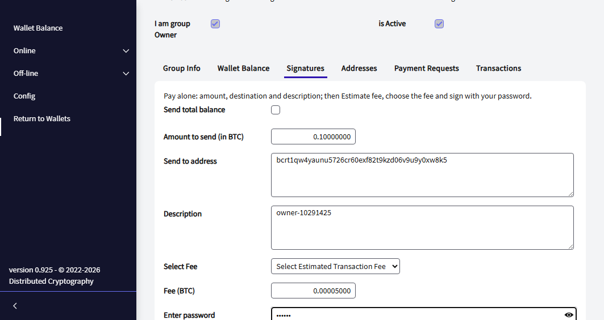
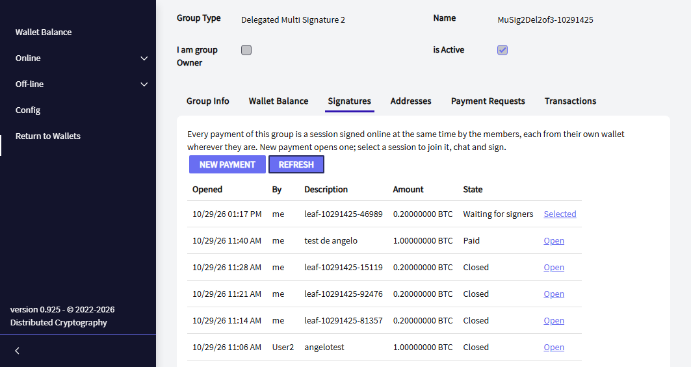
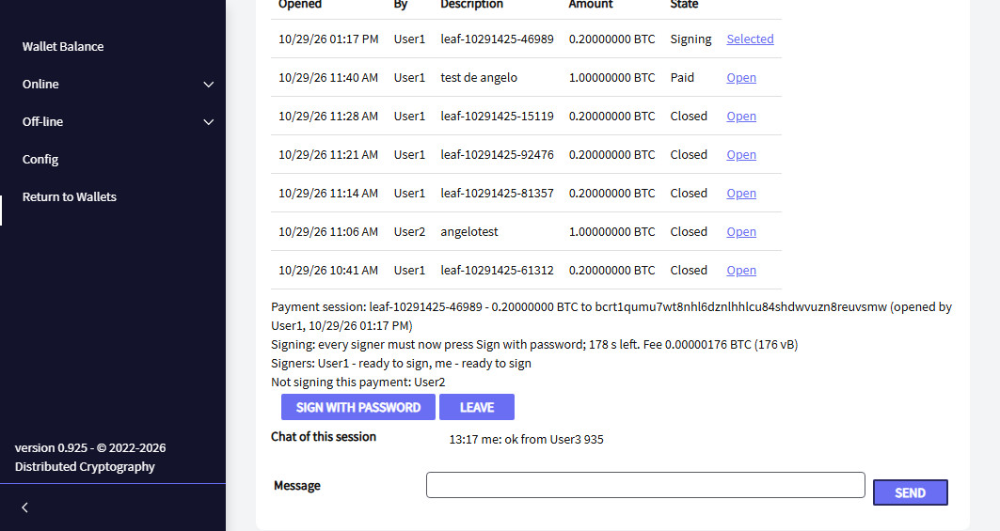

import { Steps } from '@astrojs/starlight/components';

The MuSig2 wallets are the **cheapest and most private** multisignature wallets of Distributed Cryptography. Their
payments look on the blockchain like a payment of **one single key with one signature**, whatever the size of the
group. The price is that the members who sign must be **online at the same time**: they sign together, live, in a
**signing room**.

:::note[A signing room is virtual]
The signing room is **not a place**. It is a page of the app, the **Signatures** tab of the group, that every
member opens **in their own wallet, on their own computer, wherever they are in the world**. The members never meet
and never share a screen: each one only needs the app open and an internet connection **during the same few
minutes**. The app connects them through encrypted messages.

Think of it as a short online meeting: the group agrees on a time (by chat, phone or email), everybody opens the
group at that time, and the payment is signed in a couple of minutes.
:::

There are two of them, like their non-MuSig2 brothers:

| | Delegated Multi Signature 2 | Multi Signature 2 |
|---|---|---|
| Can somebody pay alone? | **Yes, the owner** (the creator of the group) | **No**, nobody |
| The creator of the group | The owner: pays alone, is not one of the N | One more signer of the N |
| K of the N sign together | Yes, online at the same time (signing room) | Yes, online at the same time (signing room) |
| When **all** N are online in the room | - | The cheapest payment of all: one signature for the whole group |
| Brother without MuSig2 | [Delegated Multisignature](/groups/delegated-multisignature/) | [Multi Signature](/groups/multi-signature/) |

| | |
|---|---|
| Addresses | Taproot (they start with `bc1p`; with `tb1p` or `bcrt1p` on the test networks) |
| A payment of K members shows | One aggregated key and one 64-byte signature (instead of K keys and K signatures) |
| Minimum | At least 2 signers (with 1, use [Delegated Multisignature](/groups/delegated-multisignature/)) |
| Size of the group | Up to 500 combinations of K signers (for example 2 of 32, 3 of 15, 4 of 12, 8 of 12) |
| Standards | [BIP341](https://github.com/bitcoin/bips/blob/master/bip-0341.mediawiki) Taproot, [BIP327](https://github.com/bitcoin/bips/blob/master/bip-0327.mediawiki) MuSig2, [BIP386](https://github.com/bitcoin/bips/blob/master/bip-0386.mediawiki) / [BIP390](https://github.com/bitcoin/bips/blob/master/bip-0390.mediawiki) descriptors |

## Which one?

| | Signed one after the other (Delegated, Multi Signature, Legacy) | Signed live (MuSig2 wallets) |
|---|---|---|
| When do the signers sign? | Whenever each one can, hours or days apart | Online at the same time (each from wherever they are), within 3 minutes |
| Size of a payment of K signers | Grows with K | The same for any K |
| What the payment reveals | The K keys that signed | One key |
| Fee | Chosen by the first signer, with options for the last one | The network's at the moment of signing |

Choose a MuSig2 wallet when the signers can be **online at the same time** to pay - each from their own computer, in
any city or country: the treasury of a team spread over several countries that agrees on a time to pay, the savings
of a couple. Choose the others when the signers are rarely online at the same time.

## How it works

Each address has one small script for every combination of K signers, and **each script is a single MuSig2 key**:
the [BIP327](https://github.com/bitcoin/bips/blob/master/bip-0327.mediawiki) aggregate of the keys of those K
people. To pay, those K people run MuSig2 together:

1. **Round 1 - nonces.** Each signer's wallet creates a fresh secret number (a *nonce*) and sends its public part to
   the others. No password is needed for this, and it happens by itself.
2. **Round 2 - signatures.** Each signer types the password; the wallet makes a *partial signature* and sends it.
3. **Aggregation.** When every partial signature is there, any of them combines them into one Schnorr signature,
   checks it and sends the payment to the network.

The secret nonces **never leave the memory of the app** - not to a file, not to the browser - and each one is used
once. A secret nonce used twice could give away the private key, so if anything goes wrong (somebody leaves, the
time runs out, the app restarts) the room is closed and a new one starts with new nonces.

In a **Multi Signature 2** group the address can also be spent by the aggregate of **all** the N signers (the
Taproot *key path*). When every signer has joined the room (online), the payment uses it: it does not even reveal a
script.

## Before you start

- You are [logged in](/online/).
- Every person you want in the group is an **accepted** [contact](/online/contacts/).

## 1. Create, invite, accept, activate

Exactly as for [Multi Signature](/groups/multi-signature/): open **Online → Smart Groups → Create Group**, choose
**Delegated Multi Signature 2** or **Multi Signature 2**, add the members and the minimum (at least 2), send the
invitations; each member accepts; the creator activates the group.

In a **Delegated Multi Signature 2** group the minimum counts only the members; in a **Multi Signature 2** group the
creator is one more signer.

## 2. Receive

The **Wallet Balance** tab shows the next receiving address and its QR, the balance and the **Descriptors**. The tabs
**Addresses**, **Payment Requests** and **Transactions** work like the ones of your own wallet.

## 3. Pay

Every payment of a MuSig2 wallet is made in the group's **Signatures** tab.

### The owner pays alone (Delegated Multi Signature 2)

<Steps>

1. In **Signatures** click **Pay alone**. Type the amount, the destination and a description.
2. Click **Estimate fee** and choose one of the three fees.
3. Type your password and click **Pay**. One signature, sent at once.

</Steps>



### The members pay together: the signing room

Each member does these steps **in their own wallet**, from wherever they are; the app keeps everybody's screen up to
date by itself. Agree on a time first, so that the signers are online together.

<Steps>

1. **Open a payment session.** A member clicks **New payment**, types the amount, the destination and a description,
   and clicks **Open payment session**. Every member of the group receives it (a notification if they are on another page)
   and the room waits **15 minutes** for the signers to join. (The one who opens a room needs the
   group's balance in his wallet: click **Rescan Balance** in **Wallet Balance** first.)

2. **Join it.** The other members open the group's **Signatures** tab in their own wallet. The tab lists every
   payment session of the group; the open one is selected, and below the list it shows what it pays, who has
   joined (*Joined (online now)*) and who has not yet (*Not joined yet*). Each member clicks **I'm here** to say they
   are online and agree with the payment. The session has its own **chat**, to ask or confirm anything while it is
   open.

   

3. **Start signing.** When enough members have joined, the one who opened the session clicks **Start signing**. It
   does not sign anything yet: it fixes who signs. The wallet fixes
   who signs (the members present), the coins and the fee - the network's fee at that moment - and every signer's
   wallet checks the payment, reads its coins from its own server and exchanges its nonces by itself.

4. **Sign with password.** Each signer clicks **Sign with password**, types the password and clicks **Sign**. The
   signers have **3 minutes**. Until the last signature they see *Signature sent*.

   

5. **Transaction broadcast.** The last signature completes the payment and sends it to the network: that signer
   sees *Transaction broadcast* with its transaction id, and the session shows *Paid* for everybody.

</Steps>

Anybody in the session can click **Leave**: it closes for everybody and its nonces are wiped. A session whose time
runs out closes by itself.

## 4. See the group in another wallet (descriptors)

In **Wallet Balance** click **Descriptors**. The group is described by two standard descriptors, one for the
receiving addresses and one for the change:

```
Delegated Multi Signature 2:  tr(OWNER/*,{pk(musig(xpubA/*,xpubB/*)),...})
Multi Signature 2:            tr(musig(xpubA/*,xpubB/*,xpubC/*),{pk(musig(xpubA/*,xpubB/*)),...})
```

`musig()` is the BIP390 way to write a MuSig2 key. Bitcoin Core 30 and later derive every address of the group from
these descriptors; our tests check it on every release.

## Good to know

- **Online, not in person.** The signers never have to be in the same place: each one signs from their own wallet,
  anywhere in the world. What they share is the time: if a signer is not online during those minutes, the room cannot
  complete - open it again at a time that suits everybody, or use a wallet that is signed one after the other.
- **Nothing secret travels.** The room only carries the payment, the public nonces and the partial signatures,
  encrypted for each member; the live part is not even stored by the relays.
- **Back up your own wallet** as usual: your keys of the group come from it.

## Related

- [What is a Smart Group?](/groups/)
- [Multi Signature](/groups/multi-signature/)
- [Delegated Multisignature](/groups/delegated-multisignature/)
- [Bitcoin multisignature: a practical guide](/guides/multisig/)
