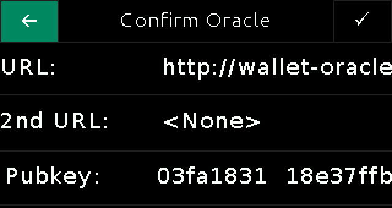
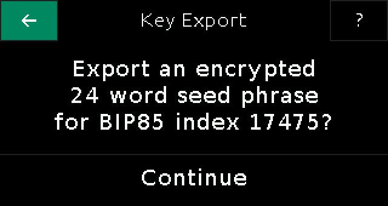
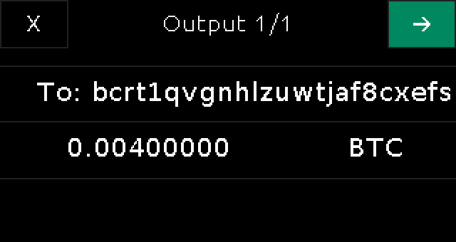
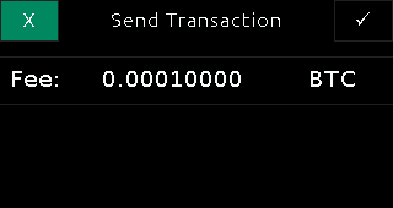
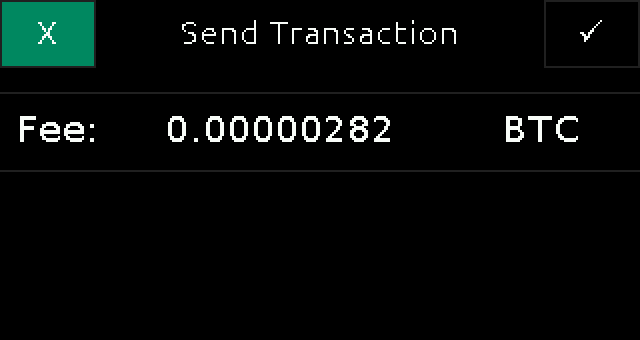

import { Steps } from '@astrojs/starlight/components';

A **Jade wallet** is a normal wallet of the application whose words and spending keys live **on a Blockstream Jade**,
with the firmware Blockstream signs (the Jade as you buy it). The Jade shows every payment on its own screen and signs
it only when you confirm. To compare it with Ruby and Trezor, see [Hardware keys](/hardware-keys/).

[Ruby](/wallet/ruby/), our own hardware key, is a fork of the Jade firmware. A Jade you buy cannot run Ruby, but it
does not need to: it works as a Jade wallet.

- **The wallet is connected, not created.** The Jade has its words and its PIN, or gets them the first time. The
  application only reads the public keys of one account of the Jade and remembers which Jade it is.
- **The Jade confirms every payment.** No password is asked to pay: the confirmation on the Jade is the approval.
- **The PIN is typed on the Jade** and checked with a *blind oracle* that you choose (below).
- **Everything else works as in any wallet:** balance, addresses, [anonymous login](/online/), contacts, chat,
  encrypted files and the off-line tools.

:::caution[Tested with the emulator]
Jade wallets are in the application since version 1.010. They were tested with an emulator of the official Jade
firmware (version 1.0.41), not yet with a physical Jade. Try it with a small amount first.
:::

## What you need

- A **Blockstream Jade** with its official firmware, and a USB cable. The computer sees it as a serial port, like
  [Ruby](/wallet/ruby/#your-computer).
- **Blockstream Green closed** while you use the wallet: only one program can use the Jade's port.
- With Blockstream's oracle: internet.

## Choose the PIN oracle

A Jade does not keep its PIN. To unlock, it asks a server, the *oracle*, for its half of a secret. The oracle never
sees the PIN or the words ("blind"), it counts the attempts, and after 3 wrong PINs it forgets the Jade while the Jade
erases its keys. The words restore it.

When you create the wallet you choose the oracle:

| | **Blockstream's oracle** (the default) | **The oracle of this wallet** |
|---|---|---|
| The Jade | as it is: new, or already set up (with Blockstream Green, for example) | must have **no PIN**: a Jade already set up must be reset first |
| Internet | needed at every unlock: the application passes the Jade's request to Blockstream | not needed: the oracle answers from inside your wallet file |
| Who can unlock the Jade | any application that talks to Blockstream's oracle: Blockstream Green, this wallet, your other Jade wallets | **only this wallet file**: keep a backup of it |
| Several wallets of the application on one Jade (a BIP86 and a BIP84 wallet, for example) | yes | no: one Jade, one wallet |
| If the wallet file is lost | the Jade still opens (Blockstream Green, a new wallet file) | the Jade cannot be unlocked: reset it and restore its words. Your bitcoin is safe with the words |

**To reset a Jade** (only for the oracle of this wallet): make sure you have its words, then on the Jade open
**Options → Device → Factory Reset** and type the number it shows. The Jade erases everything and starts as new. A
factory reset also brings back Blockstream's oracle.

## Create a Jade wallet

<Steps>

1. Open **Wallets → Create a new wallet**. Type a **name** and choose the **network**.

2. In **Where the keys live**, choose **Jade hardware wallet (Blockstream)**. The application looks for the Jade and
   shows it with its state: *READY* (unlocked), *LOCKED* (has a PIN) or *UNINIT* (new). If the list is empty, connect
   the Jade, close Blockstream Green and click **Find Jade**.

3. Choose the **Type of wallet**: **BIP86 (Taproot)** (the default),
   BIP84 (native SegWit), BIP49 (SegWit in P2SH) or BIP44 (Legacy).

4. Choose the **PIN oracle of the Jade**: Blockstream's, or the one of this wallet. With the second one the page
   reminds you that the Jade must be reset first, and that the wallet file is needed to unlock it.

5. Type a **password** twice. It protects the wallet file on this computer. *Use 2FA (authenticator)* is optional.

6. Click **Create Wallet**, and follow the Jade.

</Steps>

On the Jade, in this order:

<Steps>

1. **Only with the oracle of this wallet: Confirm Oracle.** The Jade shows the new oracle, a name and a key. The name
   is only a label: nothing goes to the internet, your wallet answers. Confirm with ✓.

   

2. **The words.** A new (or reset) Jade offers to create new words, which you write down, or to restore yours. A Jade
   that already has its words skips this step.

3. **The PIN.** A new Jade asks you to choose a PIN of 6 digits and to confirm it. A Jade that has one asks it once.

   

4. **Key Export.** The Jade asks to export a set of 24 words made from its own words (BIP85). They give the
   wallet its keys for login, chat, groups and files, which **cannot spend**. The Jade sends them encrypted to the
   application, which keeps them in the wallet file under your password. It is asked **only once**, now.

   The Jade selects **←** (no) first: turn the wheel to **Continue** and press.

   

</Steps>

The Jade shows its home screen, *Active*: the wallet is created. If you decline the Key Export, the wallet is not
created: the application needs those words once.

## Open the wallet

Click the wallet in **Wallets** and type its password. The Jade asks its **PIN** on its own screen. The application
then checks that the Jade holds **the same wallet** as when the wallet was created. Another Jade, or this one
restored with other words, gives *This Jade holds another wallet*.

A Jade used on MainNet cannot be used on a test network (or the other way round) without a factory reset: the Jade
keeps the network of its first unlock.

## Send a payment

Click **Send** and fill in the address, the amount and the fee as in any wallet. No password is asked: the button
says **Send Coins (confirm on the Jade)**.

The Jade shows the payment. Check it **on the Jade**, not on the computer:

| Output 1/1: the address and the amount | Send Transaction: the fee |
|---|---|
|  |  |

On *Send Transaction* the Jade selects **X** first. Turn the wheel to **✓** and press to sign. The change goes back to
an address of this same wallet: the Jade checks that by itself and does not show it.

**To decline**, press with **X** selected. The Jade signs nothing, and the application says *The payment was declined
on the Jade*.

## Increase the fee or cancel a payment

A payment that is not in a block yet can get a higher fee, or be cancelled, as in any wallet: open the
**Transactions** tab, click the payment, then **Increase fee** or **Cancel payment**, the new fee, **Preview** and
**Sign and send**. The Jade shows the new payment. For a cancel, its only output is marked *Verified wallet output*
(it comes back to you), and the Jade warns that the fee is higher than the amount sent: that is expected.

## Smart Groups with a Jade

A Jade wallet of **any** type can log in, have contacts and be in a group. What it can do in each group:

| Group | A Jade wallet |
|---|---|
| [Legacy Multi Signature Wallet](/groups/legacy-multisignature/) | be a member or the owner, with a wallet of any type. Each member must use a device of their own: two wallets of the same Jade (for example its BIP84 and its BIP86 wallets) have the same keys for these groups, so they can not both be in one group. Joining asks nothing on the Jade. The first payment **registers** the group on the Jade (it shows the group and each signer; confirm with ✓), so the Jade recognises the group's change. Each payment is confirmed once per fee level |
| [Group Chat](/groups/group-chat/), [Shared passwords](/groups/shared-passwords/) | yes |
| [Consensus Backup](/groups/consensus-backup/), [Time-Encrypted Vault](/groups/time-encrypted-vault/) restore group | keep **somebody else's** backup, as a member. Nothing is asked on the Jade |
| Delegated, Multi Signature and the two Advanced wallets | no: the official firmware signs Taproot only the simple way |
| A backup of **this** wallet (Consensus Backup, Time-Encrypted Vault) | no: the Jade never gives its seed. Its backup is its words |
| The bounty group of a Time-Encrypted Vault | no |

If you try one of the groups a Jade cannot do, the application says so at once, when you create the group or accept
the invitation. For every group type on a hardware key, use [Ruby](/wallet/ruby/).

## Your backup is the words

A Jade wallet uses **no passphrase**: the words alone are the wallet. The wallet password only protects the wallet
file on this computer (and, with the oracle of this wallet, the oracle inside it).

- **To restore with Blockstream's oracle**, restore the words on a Jade, then open the same wallet file.
- **To restore with the oracle of this wallet**, the Jade must be paired again: reset the Jade, create a new Jade
  wallet with the oracle of this wallet, and restore the words on the Jade when it asks.

:::danger[Do not type the words into the computer]
*Restore Wallet* in the application, with the words, the same type and the original password left **empty**, gives
back the same addresses, but as a software wallet: any spyware on that computer can steal the words. Do it only if
the Jade is lost, and then move the funds to a new wallet. That software wallet does not have the same chats, files
and server user as the Jade wallet: those come from the words the Jade exported.
:::

## Not used with the application

The Jade's Bluetooth and QR modes are not used: the application talks to the Jade over USB only. Blockstream's
[Jade documentation](https://help.blockstream.com/blockstream-jade) describes the Jade's own menus.
