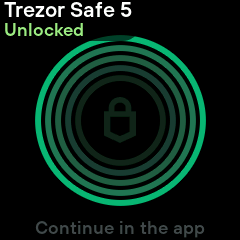
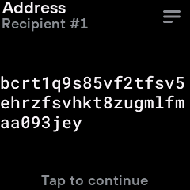
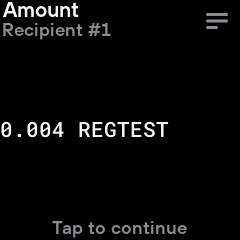
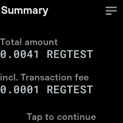
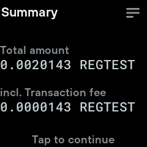
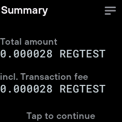

import { Steps } from '@astrojs/starlight/components';

A **Trezor wallet** is a normal wallet of the application whose words and spending keys live **on a Trezor**. The
Trezor shows every payment on its own screen and signs it only when you confirm. To compare it with Ruby and Jade,
see [Hardware keys](/hardware-keys/).

- **The wallet is connected, not created.** The Trezor already has its words and its PIN, set up in Trezor Suite. The
  application only reads the public keys of one account of the Trezor and remembers which Trezor it is.
- **The Trezor confirms every payment.** No password is asked to pay: the confirmation on the Trezor is the approval.
- **The Trezor checks its own PIN**, on its screen. The computer never sees it.
- **Everything else works as in any wallet:** balance, addresses, [anonymous login](/online/), contacts, chat,
  encrypted files and the off-line tools. The keys for those features come from the Trezor when the wallet is opened,
  without showing anything on the Trezor, and they cannot spend.

:::caution[Tested with the emulator]
Trezor wallets are in the application since version 1.010. They were tested with the official Trezor emulator
(Trezor Safe 5), not yet with a physical Trezor. Try it with a small amount first.
:::

## What you need

- A **Trezor Model T, Safe 3 or Safe 5**, already set up in **Trezor Suite**: its words written down and its PIN
  chosen.
- **Trezor Suite open** while you use the wallet. The application talks to the Trezor through Trezor Suite, so both
  can use it at the same time.
- A USB cable between the Trezor and the computer.

| Model | |
|---|---|
| Model T, Safe 3, Safe 5 | supported |
| Model One | it asks its PIN on the computer screen, which the application does not show yet. Unlock it in Trezor Suite first, then open the wallet |
| Safe 7 | not supported yet |

## Create a Trezor wallet

<Steps>

1. Open **Wallets → Create a new wallet**. Type a **name** and choose the **network**.

2. In **Where the keys live**, choose **Trezor hardware wallet**. The application looks for the Trezor and shows its
   model, name, firmware and state. If the list is empty, connect the Trezor, open Trezor Suite and click
   **Find Trezor**.

3. Choose the **Type of wallet**: **BIP86 (Taproot)** (the default, and the one for Legacy Multi Signature groups),
   BIP84 (native SegWit), BIP49 (SegWit in P2SH) or BIP44 (Legacy).

4. Type a **password** twice. It protects the wallet file on this computer; it is not part of the backup.
   *Use 2FA (authenticator)* is optional, as for any wallet.

5. Click **Create Wallet**. If the Trezor is locked, it asks its **PIN** on its own screen (the digits are in a
   different place every time).

   

</Steps>

The application reads the account of the Trezor and creates the wallet. The words never pass through the computer.

The same Trezor can have several wallets side by side, one per type (a BIP86 and a BIP84 wallet, for example). They
share the words, not the addresses.

## Open the wallet

Click the wallet in **Wallets** and type its password. If the Trezor is locked, tap its screen and type the PIN on
it.

The application checks that the Trezor holds **the same wallet** as when the wallet was created. Another Trezor, or
this one reset with other words, gives *This Trezor holds another wallet*. A Trezor restored with the **same** words
works again.

## Send a payment

Click **Send** and fill in the address, the amount and the fee as in any wallet. No password is asked: the button
says **Send Coins (confirm on the Trezor)**.

The Trezor then shows the payment, one screen at a time. Check each one **on the Trezor**, not on the computer:
malware can change what the computer shows, not what the Trezor shows.

| The address | The amount | The total and the fee |
|---|---|---|
|  |  |  |

Tap to go on, and hold on the last screen to sign. The change goes back to an address of this same wallet: the
Trezor checks that by itself and does not show it.

**To decline**, cancel on any of those screens. The Trezor signs nothing, and the application says *The payment was
declined on the Trezor*.

## Increase the fee or cancel a payment

A payment that is not in a block yet can get a higher fee, or be cancelled, as in any wallet: open the
**Transactions** tab, click the payment, then **Increase fee** or **Cancel payment**, the new fee, **Preview** and
**Sign and send**. The Trezor shows the new payment.

| Increase fee: the same payment, a higher fee | Cancel: only the fee, everything else comes back to you |
|---|---|
|  |  |

## Smart Groups with a Trezor

A Trezor wallet of **any** type can log in, have contacts and be in a group. What it can do in each group:

| Group | A Trezor wallet |
|---|---|
| [Legacy Multi Signature Wallet](/groups/legacy-multisignature/) | be a member or the owner, if the wallet is **BIP86**. Joining asks nothing on the Trezor. Each payment is confirmed on the Trezor, once per fee level |
| [Group Chat](/groups/group-chat/), [Shared passwords](/groups/shared-passwords/) | yes |
| [Consensus Backup](/groups/consensus-backup/), [Time-Encrypted Vault](/groups/time-encrypted-vault/) restore group | keep **somebody else's** backup, as a member. Nothing is asked on the Trezor |
| Delegated, Multi Signature and the two Advanced wallets | no: the Trezor signs Taproot only the simple way |
| A backup of **this** wallet (Consensus Backup, Time-Encrypted Vault) | no: the Trezor never gives its seed. Its backup is its words |
| The bounty group of a Time-Encrypted Vault | no |

If you try one of the groups a Trezor cannot do, the application says so at once, when you create the group or
accept the invitation.

## Your backup is the words

A Trezor wallet uses the Trezor's **standard wallet**, with **no passphrase**: the words alone are the wallet. The
wallet password only protects the wallet file on this computer.

- **To restore**, restore the words on a Trezor in Trezor Suite, then open the same wallet file, or create a new
  Trezor wallet with it.
- If the passphrase protection is on in the Trezor, the application uses the standard wallet (empty passphrase).

:::danger[Do not type the words into the computer]
*Restore Wallet* in the application, with the words, the same type and the original password left **empty**, gives
back the same addresses, but as a software wallet: any spyware on that computer can steal the words. Do it only if
the Trezor is lost, and then move the funds to a new wallet. That software wallet does not have the same chats, files
and server user as the Trezor wallet: those come from the Trezor.
:::
