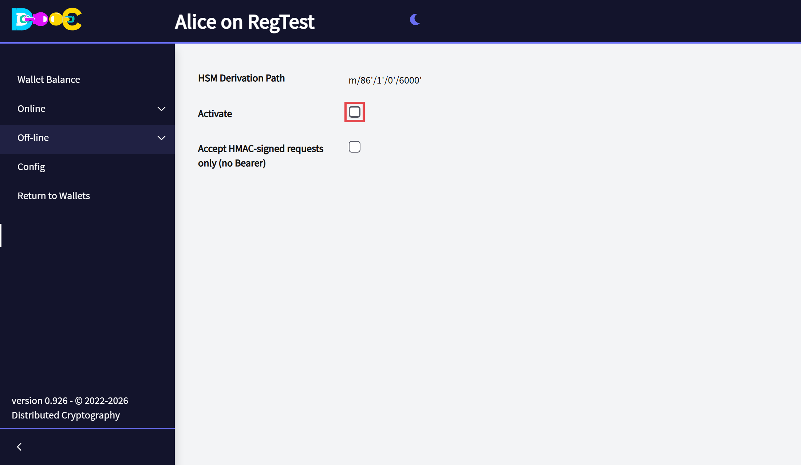
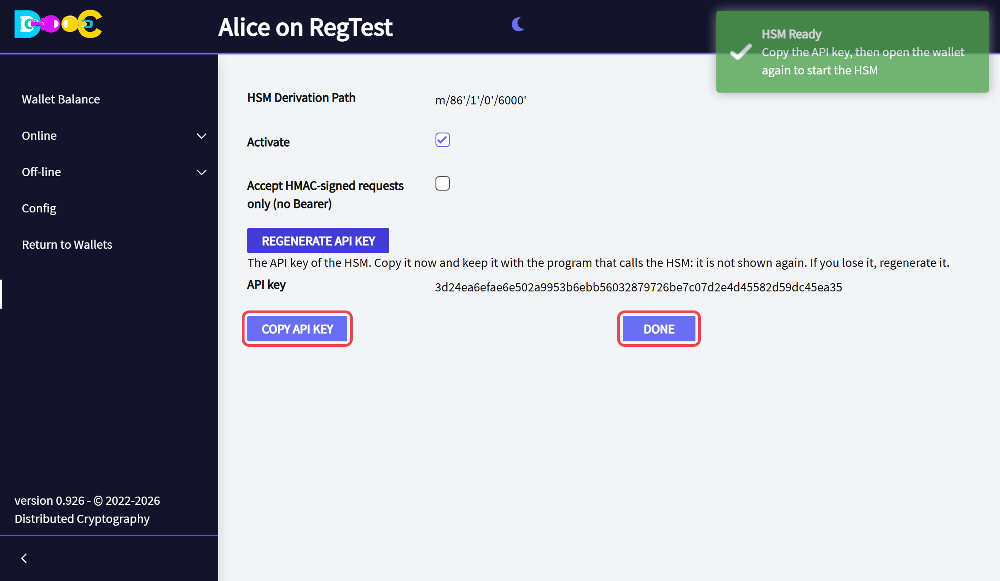
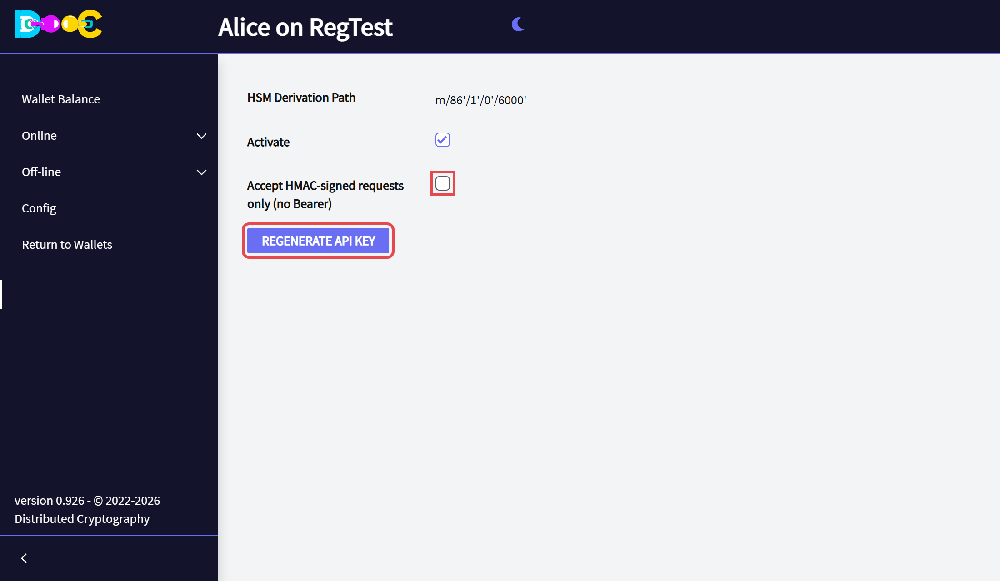

import YouTube from '../../../components/YouTube.astro';
import { Steps } from '@astrojs/starlight/components';

## What is an HSM?

An **HSM (Hardware Security Module)** is a dedicated physical device that creates, stores and protects
cryptographic keys, and does the secure operations with them: encrypting, decrypting, signing and managing
keys. Think of it as a tamper-proof vault for cryptographic secrets, used where security in software alone is
not enough.

Our HSM is not, strictly speaking, hardware. It is a service of the wallet that does the same job: **your
programs ask it to sign or decrypt, and the keys never leave it**. You can install it on a dedicated device
such as a Raspberry Pi, or in its own virtual machine or container, and allow access only from the service that
needs it.

<YouTube id="GRo7Rbxk-Pc" title="How to set up an HSM" />

## Turn it on

<Steps>

1. Open your wallet and open **Off-line → HSM**.

2. Tick **Activate** and click **Save**.

   

3. The page shows the **API key** of the HSM. Click **Copy API key** and keep it with the program that will
   call the HSM, then click **Done**. The key is shown **only this once**.

   

4. **Open the wallet again**: the HSM starts when the wallet is unlocked. From then on it keeps working after you
   close the wallet, until the application stops or you turn the HSM off.

</Steps>

The page shows the **HSM derivation path**: the keys the HSM uses come from that branch of your wallet, so they
are covered by the same words and the same backups.

To turn it off, clear **Activate** and save. The API key is deleted with it: turning the HSM on again makes a new
one.

The application runs **one HSM at a time**: the one of the last wallet opened with its HSM turned on. The
HSM page of another wallet does not change it. Regenerating that wallet's key, changing its options or turning its
HSM off leaves the running HSM and its key as they are.

## The API key

Every call to the HSM must carry its API key, **including the ones that only use public keys** (`getPubKey`,
`encrypt`, `encryptToPubKey`). Without it the HSM answers `"error": "Unauthorized"` and does nothing.

- **Lost the key, or someone else may have it?** Click **Regenerate API key**. The page shows a new key once, and
  the old one stops working at once.
- **Two ways to send the key.** A program can send the key itself (*Bearer*), or sign each request with it so the
  key never travels (*HMAC*). The HSM always accepts both. Tick **Accept HMAC-signed requests only (no Bearer)**
  (off by default) to refuse Bearer. See [HMAC-signed requests](#hmac-signed-requests) below.



The key is kept in the wallet's encrypted files. The page never shows it again: if you lose it, regenerate it.

## Use it from your programs

The HSM is a REST service at:

```
http://<the computer that runs the wallet>:5000/HSM/rest/...
```

The description of the service (OpenAPI) is the file
[`HSM.rest.yaml`](https://github.com/angelonardone/DistributedCryptography/blob/main/web/HSM.rest.yaml). Use it
to generate a client or to see every operation and its parameters.

| Operation | Method | Parameters | Answer |
|---|---|---|---|
| `getPubKey` | GET | `indexKey` (in the URL) | `publicKey`: compressed public key of the HSM key `indexKey`, in hex |
| `encrypt` | POST | `message`, `indexKey` | `encryptedMessage`: the message encrypted to that key (ECIES) |
| `encryptToPubKey` | POST | `message`, `publicKey` | `encryptedMessage`: the message encrypted to any public key |
| `decrypt` | POST | `encryptedMessage`, `indexKey` | `message` |
| `sign` | POST | `message`, `indexKey` | `signature`: compact ECDSA signature of the double SHA-256 of the message |
| `SignSchnorr` | POST | `message`, `indexKey` | `signature`: Schnorr signature (BIP340) of the double SHA-256 of the message |

Every answer also has `error`: empty when it worked, `Unauthorized` without a valid key, `HSM not active` when the
HSM is not running (open the wallet once after turning it on).

### With the API key (Bearer)

Send the key in the `Authorization` header:

```bash
curl -H "Authorization: Bearer <api key>" "http://localhost:5000/HSM/rest/getPubKey?indexKey=0"

curl -X POST "http://localhost:5000/HSM/rest/sign" \
     -H "Authorization: Bearer <api key>" -H "Content-Type: application/json" \
     -d '{"message":"hello","indexKey":0}'
```

This is enough when the program runs on the same computer as the wallet, or reaches it through HTTPS.

### HMAC-signed requests

With HMAC the key never travels. The program signs each request with it, and someone who sees a request on the
network can neither reuse it nor learn the key. Use it when the requests travel over a network in plain HTTP.

Each request carries three headers instead of `Authorization`:

| Header | Value |
|---|---|
| `X-HSM-Timestamp` | the current time in Unix seconds (UTC). The HSM accepts 5 minutes of difference with its clock |
| `X-HSM-Nonce` | a random text of 16 to 128 characters (letters, digits, `-`, `_`), new for every request. The HSM accepts each one once |
| `X-HSM-Signature` | the HMAC-SHA256 of the text below, with the API key as the key, in lowercase hex |

The text to sign is these lines joined with a line break (`\n`), with no line break at the end:

```
DC-HSM-HMAC-SHA256
<operation>                    for example: sign
<X-HSM-Timestamp>
<X-HSM-Nonce>
<SHA-256 of the 1st parameter, in lowercase hex>
<SHA-256 of the 2nd parameter, in lowercase hex>
```

The parameters go in the order of the table above (`getPubKey` has only `indexKey`). Write `indexKey` in decimal,
`0` for example, and always send it. Text is encoded in UTF-8.

A complete client in Python, with the standard library only:

```python
import hashlib, hmac, json, secrets, time, urllib.request

API_KEY = "<api key>"
BASE = "http://localhost:5000/HSM/rest/"

def sha256_hex(text):
    return hashlib.sha256(text.encode("utf-8")).hexdigest()

def hmac_headers(operation, parameters):
    timestamp = str(int(time.time()))
    nonce = secrets.token_hex(16)
    text = "\n".join(["DC-HSM-HMAC-SHA256", operation, timestamp, nonce]
                     + [sha256_hex(str(p)) for p in parameters])
    signature = hmac.new(API_KEY.encode("utf-8"), text.encode("utf-8"), hashlib.sha256).hexdigest()
    return {"X-HSM-Timestamp": timestamp, "X-HSM-Nonce": nonce, "X-HSM-Signature": signature}

# sign "hello" with the HSM key 0
body = {"message": "hello", "indexKey": 0}
headers = {"Content-Type": "application/json", **hmac_headers("sign", ["hello", 0])}
request = urllib.request.Request(BASE + "sign", data=json.dumps(body).encode("utf-8"), headers=headers)
print(json.load(urllib.request.urlopen(request)))
```

HMAC works whether **Accept HMAC-signed requests only (no Bearer)** is ticked or not: the box only decides whether
Bearer is still accepted. So you can move a program to HMAC first and then tick the box. With the box ticked, a
request with the key in `Authorization` is refused.

:::danger[Keep the HSM away from networks you do not trust]
The API key protects every call, but the HSM is still a service that signs. Expose it as little as possible:

- Run it on a dedicated machine, virtual machine or container.
- Use a firewall so that only the service that needs it can connect.
- With Docker, publish the port only on your own machine: `127.0.0.1:5000:5000`. See
  [Run with Docker](/install/docker/).
:::
