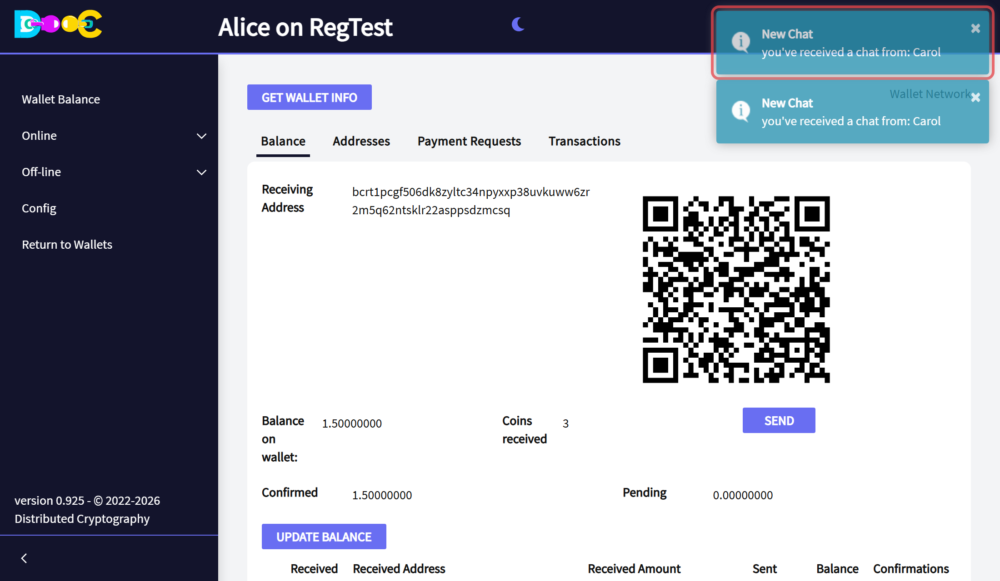
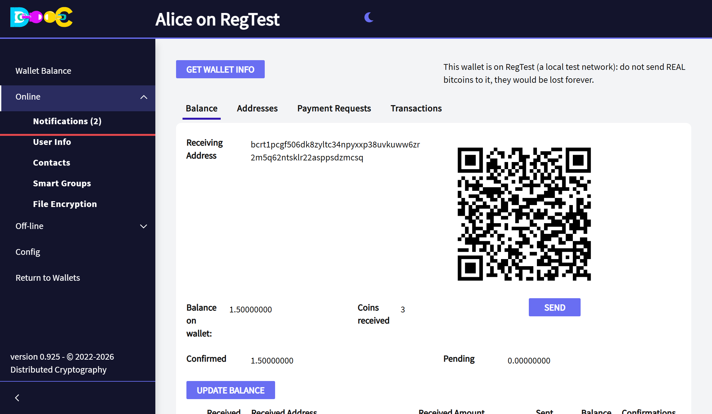
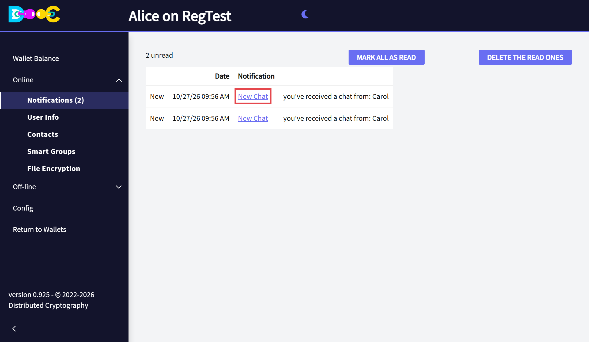
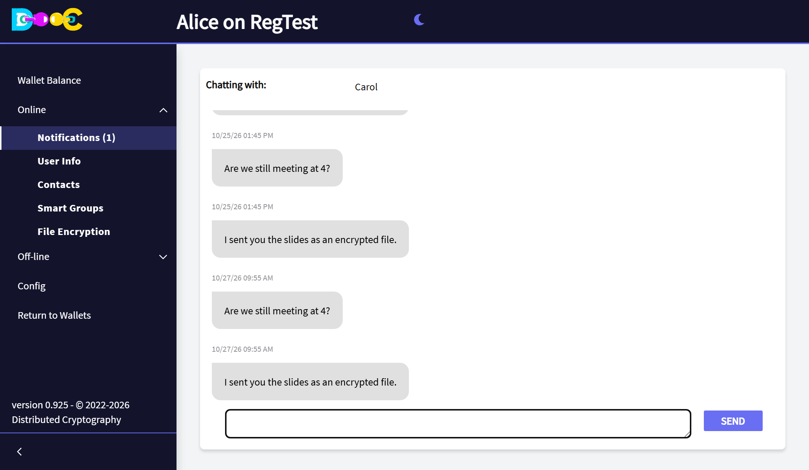
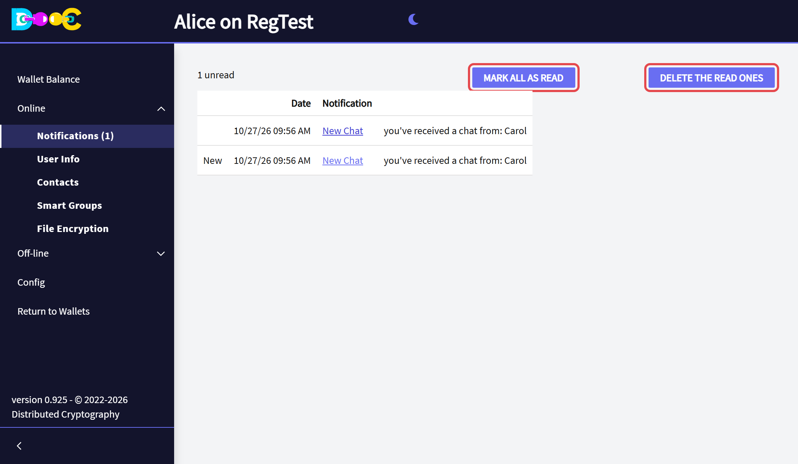

import { Steps } from '@astrojs/starlight/components';

:::tip[Next release]
The Notifications page and the notices that stay on screen are part of the next release of Distributed Cryptography.
They are not in the version you can download today.
:::

When something arrives for you, the wallet tells you with a notice in the top right corner. A notice can be:

- a new chat message;
- a contact invitation, or a contact who accepted yours;
- a group invitation, a member who accepted, a group that was activated or restored;
- a signature of a group payment, or a group payment that was completed.

The messages that arrive while your wallet is closed are delivered the next time you open it, with their notices.

## The notices

Each notice **stays on screen until you close it** with its **×**. Several notices pile up, one under the other.

Click a notice to go straight to what it is about: the chat with that contact, your contacts, or the group.

## The Notifications page

A notice disappears when you go to another page. The wallet keeps every notice anyway, so you can find it later.

<Steps>

1. Open **Online → Notifications**. The number in brackets is how many notices you have not opened yet.

   

2. The newest notices are at the top. The unread ones say **New**. Click the **title** of a notice to go to what it is about.

   

3. The title takes you to the chat, the contacts or the group, and marks the notice as read.

   

4. Back on the page, the notice you opened is no longer **New**. **Mark all as read** marks the rest, and
   **Delete the read ones** removes the notices you do not need any more.

   

</Steps>

## Good to know

- The notices are stored **inside your wallet**, encrypted like the rest of its files. The wallet keeps the last 200.
- A notice shows only plain text: a message can never run code in your wallet.
- Deleting a notice does not delete the chat message, the group or the payment it was about.

## Related

- [Chat](/online/chat/)
- [Contacts](/online/contacts/)
- [What is a Smart Group?](/groups/)
