import { Steps } from '@astrojs/starlight/components';

:::note[Next release]
Increase fee, Cancel payment, Send again and Forget come with the next release of the application, for the personal
wallet. Smart Groups come later.
:::

A payment waits in the network until a miner puts it in a block. Miners take the payments that pay the most per
byte first, so a payment with a low fee can wait for hours, or for days when the network is busy.

While a payment is **not in a block yet**, the wallet can replace it:

- **Increase fee**: the same payment, with a higher fee. It gets into a block sooner.
- **Cancel payment**: a new transaction, also with a higher fee, sends the coins back to your wallet instead. The
  person you paid gets nothing.

Both use *replace-by-fee* ([BIP 125](https://github.com/bitcoin/bips/blob/master/bip-0125.mediawiki)): every payment
the wallet sends says that it may be replaced, and the network keeps the one that pays more. Once a payment is in a
block it can no longer be replaced or cancelled.

In the pictures, the red frame shows what to click or fill in at each step.

## Increase the fee

<Steps>

1. A payment sent with a low fee (here, a fee typed by hand) shows up in **Transactions** as *Sent*, with 0
   confirmations.

   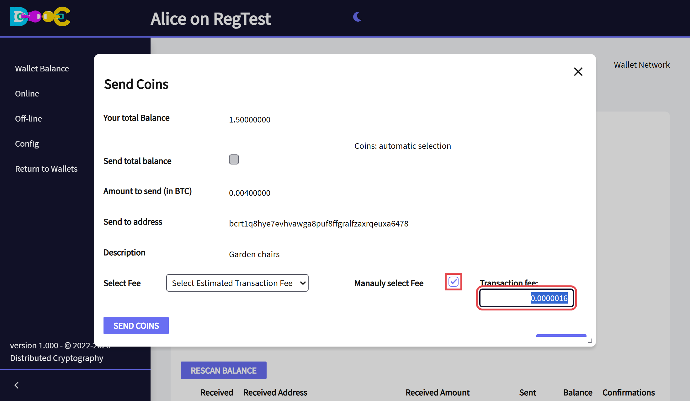

2. Open the wallet, go to **Transactions** and click the type of the payment, **Sent**.

   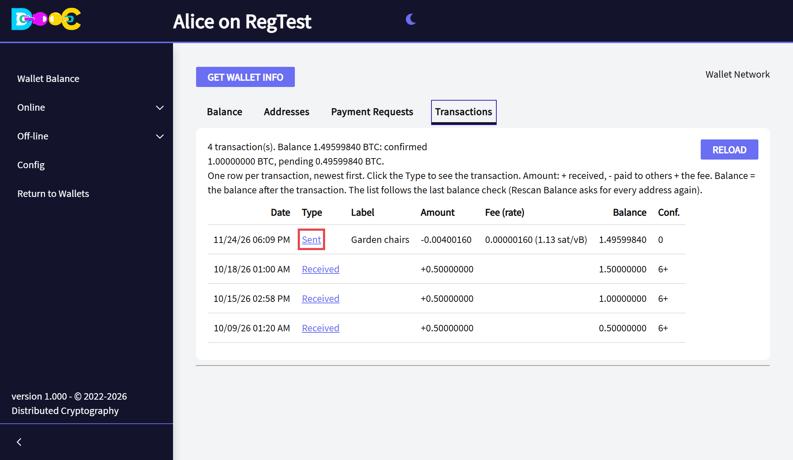

3. The window of the payment shows what it paid, its fee in sat/vB, its inputs and its outputs. While it is not in
   a block, it has two buttons: **Increase fee** and **Cancel payment**. Click **Increase fee**.

   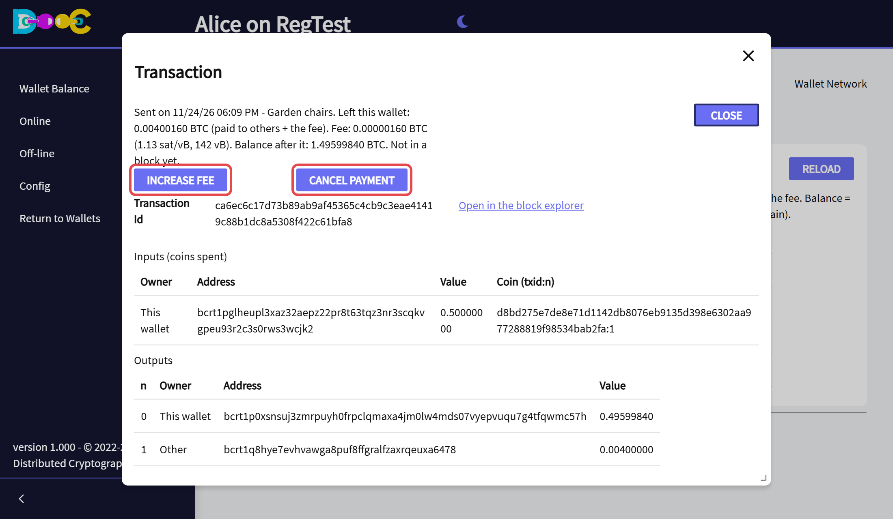

4. Choose one of the **Estimated fee rate** options (they come from the Electrum server) or type the **New fee
   rate** in sat/vB. It must be higher than the rate the payment has now. Click **Preview**.

   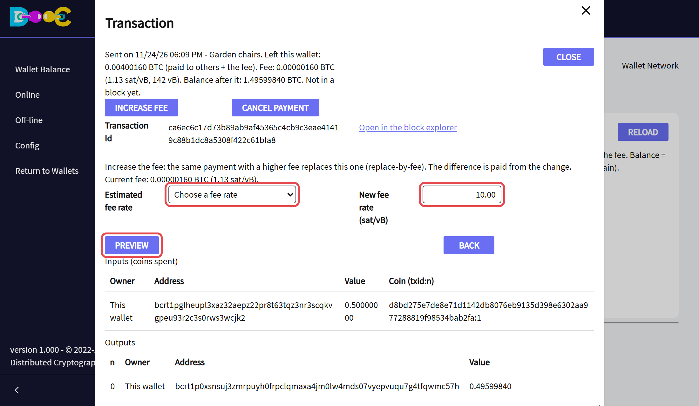

5. The preview shows the new fee, the least the network asks for a replacement, and the coins it spends. Nothing has
   been sent yet. Click **Sign and send**.

   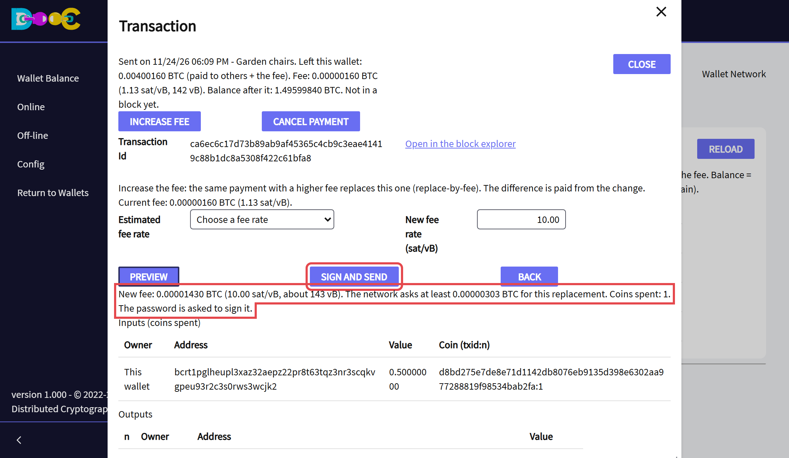

6. Type your password. The new payment is signed and sent, and replaces the old one.

   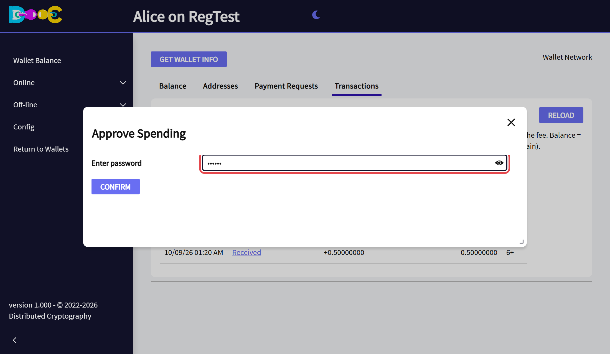

</Steps>

The row now shows the new fee. The payment pays the same people the same amounts: the extra fee comes out of the
change. If the change is not enough, the wallet adds another confirmed coin of the wallet. If there is no other coin
(for example, the payment sent the whole balance), the preview says so and shows the box **The payment pays the fee
(the receiver gets less)**: tick it and click **Preview** again.

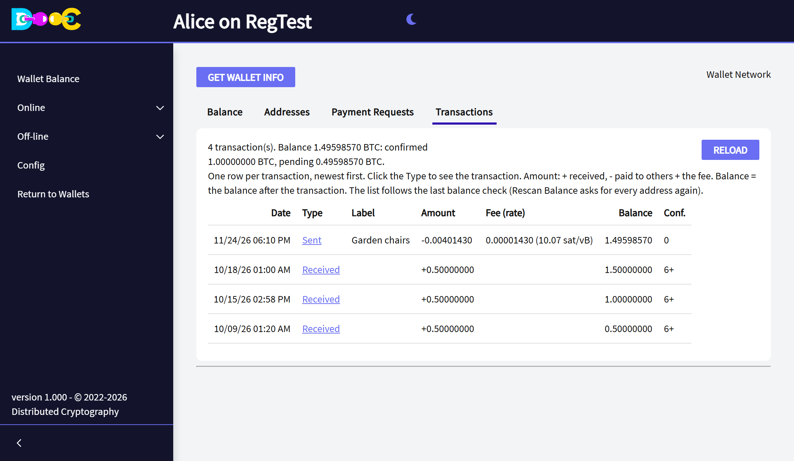

The network asks a replacement to pay more than the payment it replaces, at least 1 sat/vB more for its size. The
preview shows that minimum, and the wallet never offers less.

## Cancel a payment

<Steps>

1. Open the payment in **Transactions** and click **Cancel payment**. You can cancel a payment whose fee you already
   increased.

   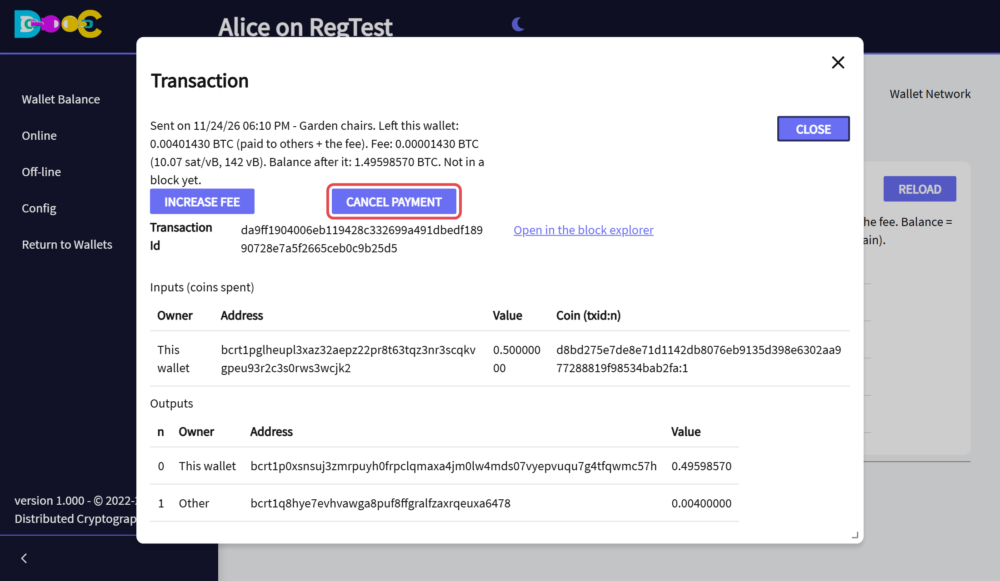

2. Choose or type the fee rate and click **Preview**. A cancel must pay more than the payment it replaces, too.

   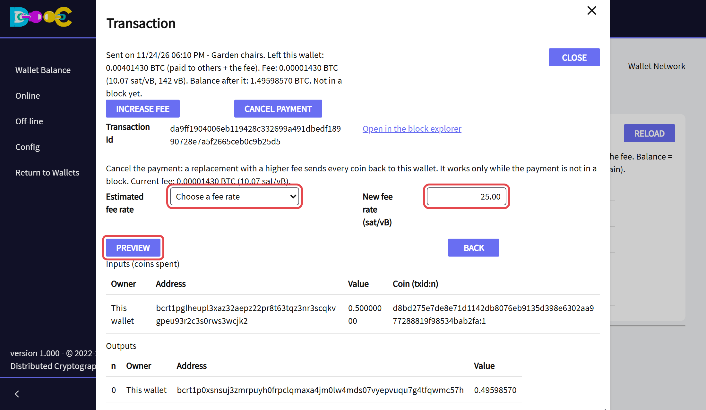

3. The preview says that every coin of the payment comes back to the wallet. Click **Sign and send** and type your
   password.

   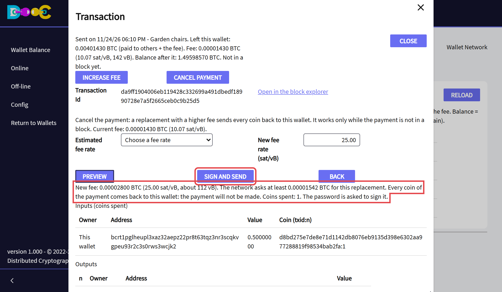

</Steps>

When the cancel is in a block, the row shows it as **To yourself**: the only thing it cost is its fee.

:::caution[A cancel is a race]
Until the cancel is in a block, the first payment can still be mined, for example by a miner that never saw the
cancel. Cancel only what you can afford to have paid anyway, and never as a way to take back a payment from
somebody who already gave you something for it.
:::

## A payment the network dropped

Sometimes a payment never reaches a block and the network forgets it: its fee was too low for too long, or the
servers that had it restarted. Every **Rescan Balance** asks the Electrum server about the payments that are not in
a block yet. When the server no longer knows one, its row says **Dropped by the network**.

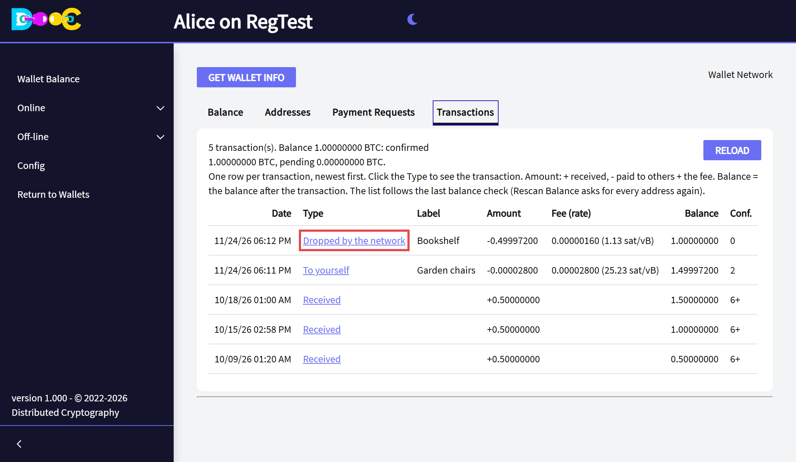

Its coins are held until you decide what to do: the balance does not count them, and the row shows the whole coins
it spends (its change too, because that change does not exist while the payment is not in the network). Open the
payment:

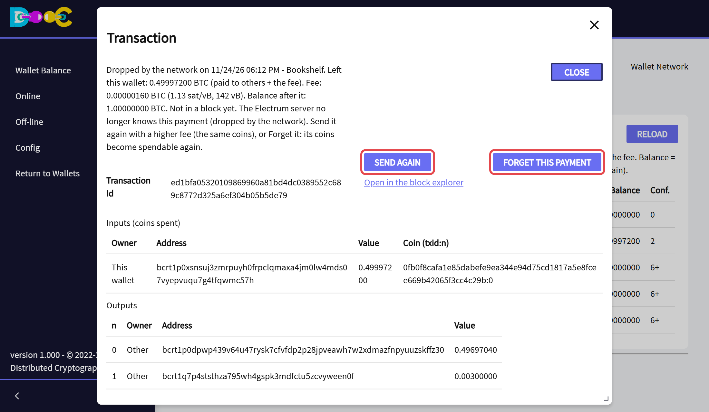

- **Send again**: the same payment, with the same coins and a fee rate you choose (Preview, then Sign and send with
  your password, as above). When it is in a block, the row shows it as *Sent* with its new fee.

  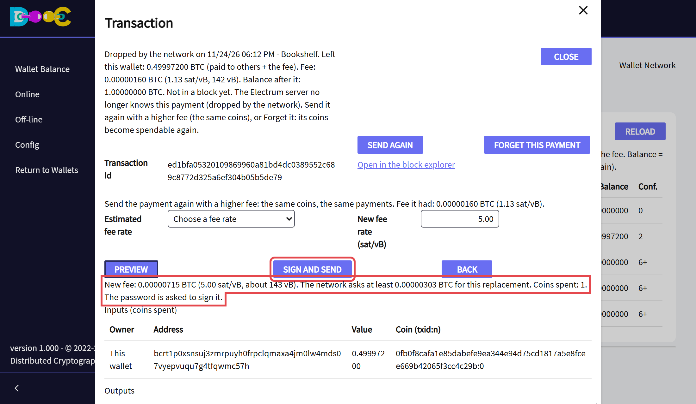

- **Forget this payment**: the wallet asks for a confirmation, then asks the Electrum server once more and, if it
  really does not know the payment, the coins become spendable again and the row is removed.

  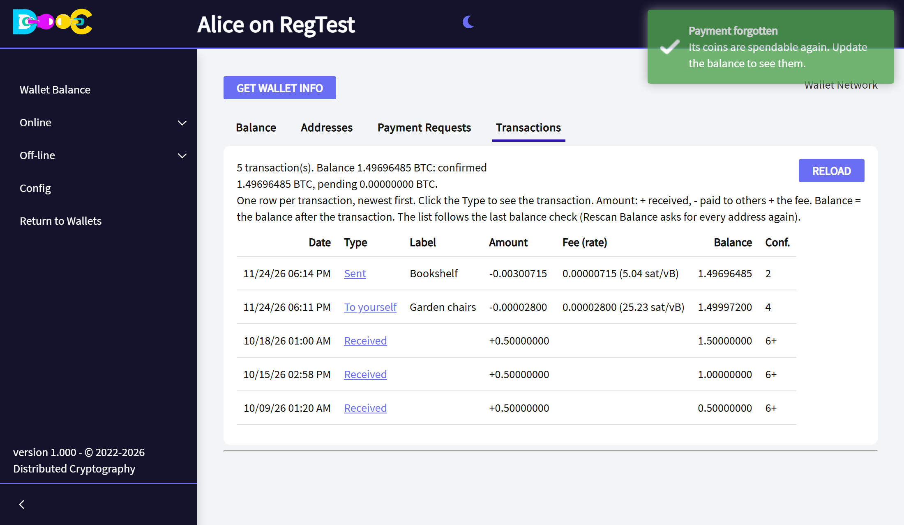

Forget only a payment you do not want to make any more. If somebody still has a copy of it and sends it to the
network later, it can still be mined, as long as its coins have not been spent by another payment.

## Good to know

- **Payments sent with an earlier version** do not say that they may be replaced. Most nodes replace them anyway
  (Bitcoin Core does since version 28), but some may refuse the new fee.
- If you already spent the **change** of a payment in a second payment, replacing the first one also removes the
  second one from the network, and the new fee must pay for both. The network refuses a fee that is too low.
- A [Ruby](/wallet/ruby/) wallet shows the replacement on Ruby, and you confirm it there instead of typing the password.
