import { Steps } from '@astrojs/starlight/components';

:::note
What Ruby is and what you need: [Ruby hardware key](/wallet/ruby/).
:::

:::caution[Demo words]
The words in these pictures belong to a demo **TestNet** wallet and are public. Never use them, or any words you
have shown to anyone, for real funds.
:::

You need a Ruby **not set up yet** (its home screen says *Uninitialized*) connected by USB, and paper and pen for
the words. Ruby's buttons: **A** (left) = previous, **B** (middle) = select, **C** (right) = next.

## 1. Start the wallet in the application

<Steps>

1. On the wallets page click **Create a new wallet**.

2. Type a **Wallet Name** and choose the **network**: *MainNet* for real bitcoin (*TestNet* in these pictures).

3. In **Where the keys live** choose **Ruby hardware key**. The application looks for Ruby and shows it in **Ruby
   device** with its port (for example `COM4` on Windows or `/dev/cu.usbmodem…` on a Mac). If it is not there,
   check the cable and click **Find Ruby**.

4. Type the **New Password** twice. It protects the wallet file on this computer. It is not Ruby's PIN, and it is
   not needed to restore the wallet from the words.

   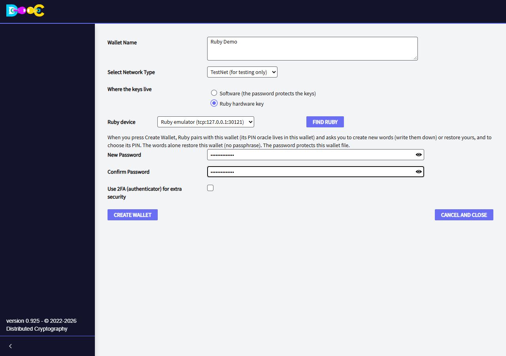

5. Click **Create Wallet**. The page turns grey and waits while you set up Ruby (up to 2 hours).

   

</Steps>

Ruby pairs with the new wallet by itself: its PIN oracle lives in this wallet, so Ruby asks nothing about it.

## 2. Set up Ruby

| | |
|---|---|
| 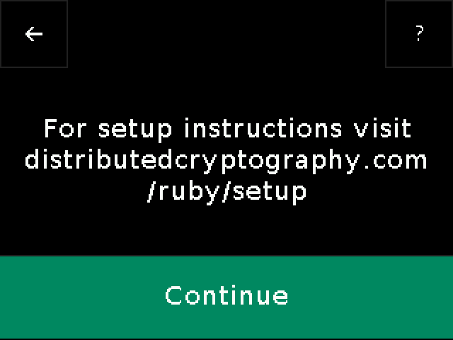 | **Continue** (B). |
| 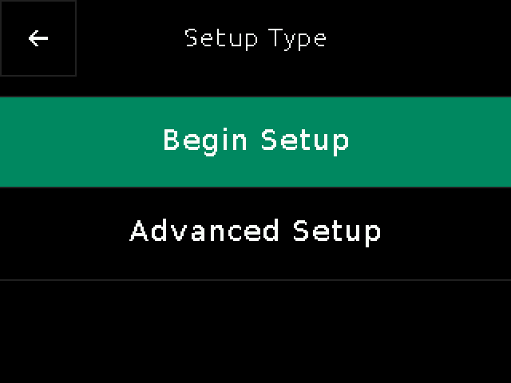 | **Begin Setup** (B). |
| 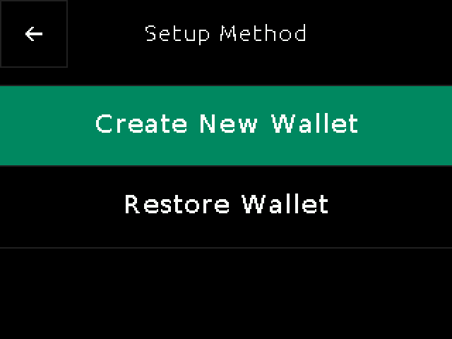 | **Create New Wallet** (B) for new words. (*Restore Wallet* is for words you already have: see [Restore a Ruby wallet](/wallet/ruby-restore/).) |
| 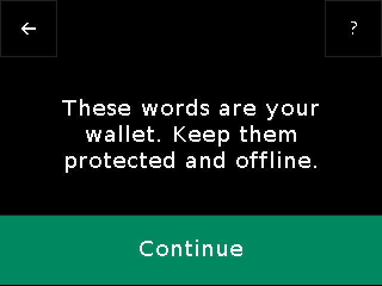 | Ruby is about to show the words: **Continue** (B). |

### Write down the 12 words

Ruby shows them in three pages of four. **Write them down in order** on paper, then go to the next page (B).

| | | |
|---|---|---|
| 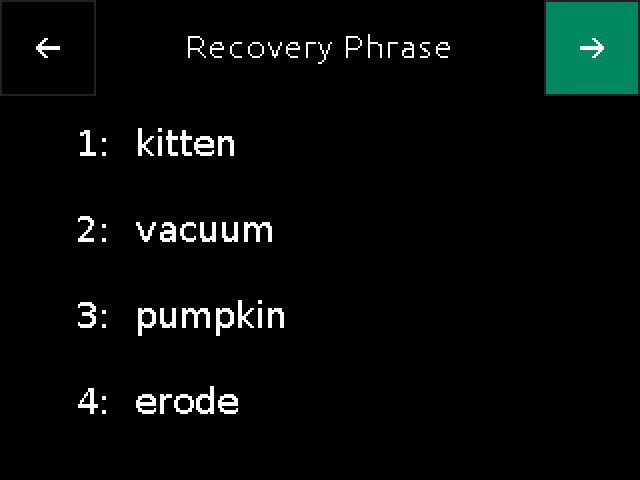 | 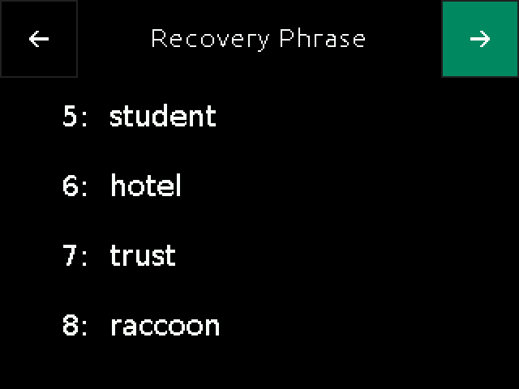 | 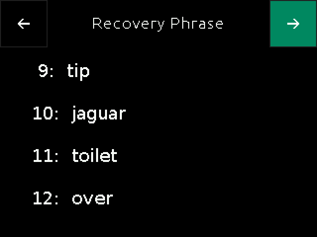 |

These words **are** the wallet: with them alone (no passphrase) it can be restored. Keep the paper offline and
never type the words into a computer.

### Confirm four words

Ruby asks for four of the words, at random. The green band is the word you choose: **C** and **A** change it, **B**
confirms it. The rows above and below show the neighbouring words, as a hint.

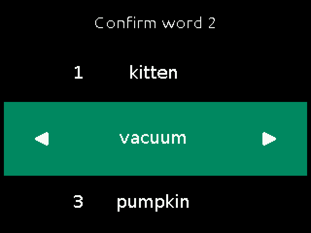

### Choose the PIN

The PIN has 6 digits. Each box is a wheel: **C** goes to the next digit, **A** to the previous one, **B** accepts
the digit and moves to the next box. Each box starts at a random digit. After 9 the wheel shows a backspace sign
(⌫): accepting it erases the previous digit.

| | |
|---|---|
| 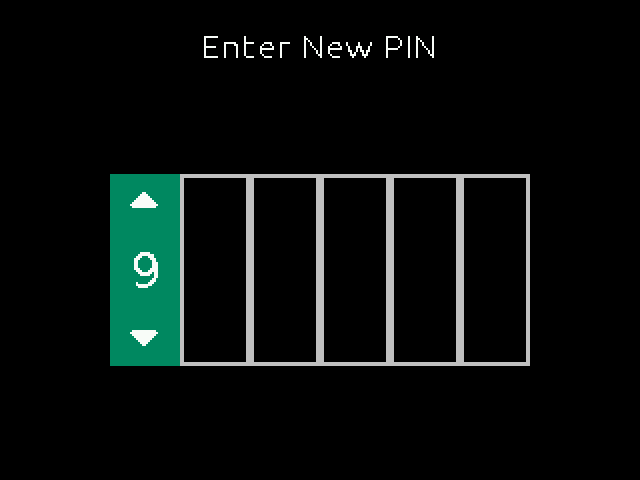 | **Enter New PIN**: the first box. |
| 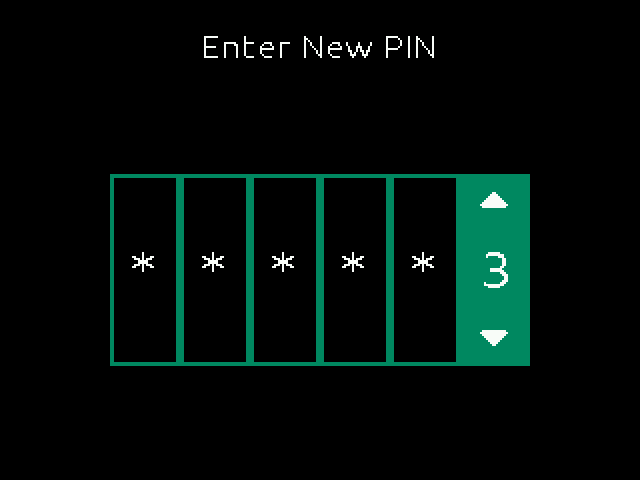 | The last digit; **B** accepts the PIN. |
| 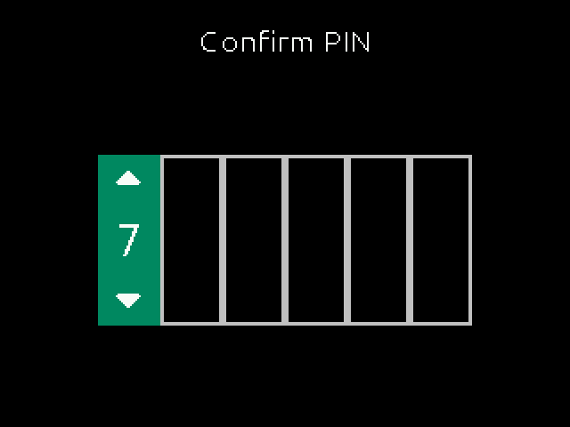 | **Confirm PIN**: the same PIN again. |
|  | Ruby stores the PIN with the wallet's oracle. |
| 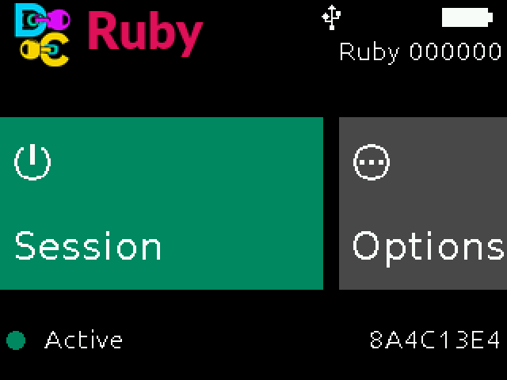 | Done: Ruby is **Active** and shows the fingerprint of its wallet. |

:::caution
Three wrong PINs erase Ruby's key. The words are then the only way back.
:::

The application finishes by itself and shows the new wallet in the list:

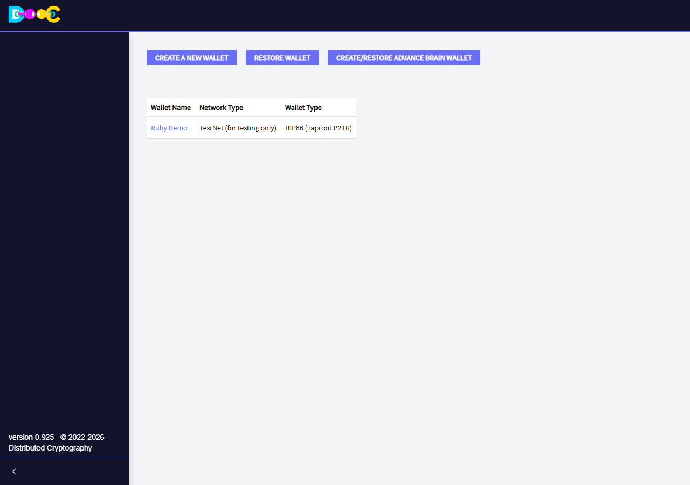

## 3. Open the wallet

<Steps>

1. Click the wallet name, type the **password** and click **Confirm**.

   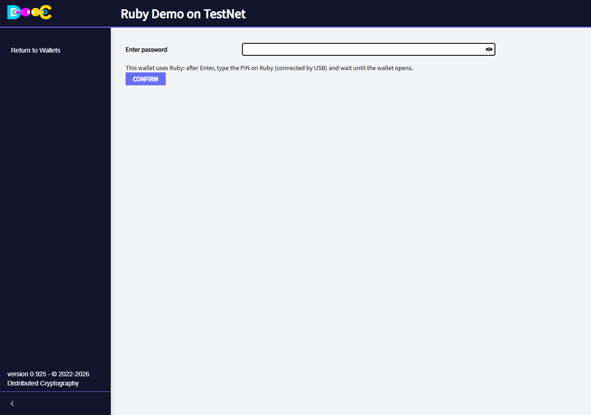

2. If Ruby is locked (it locks when it is unplugged, or after a while), it asks for its PIN: **Unlock Ruby**, with
   the same wheels as when you chose it.

   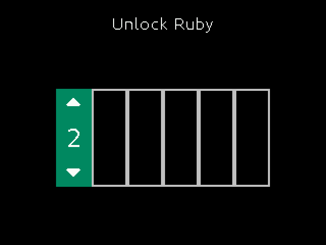

3. Ruby checks the PIN with the wallet's oracle and goes back to its home screen, **Active**. The wallet opens.
   There is nothing to confirm on Ruby.

   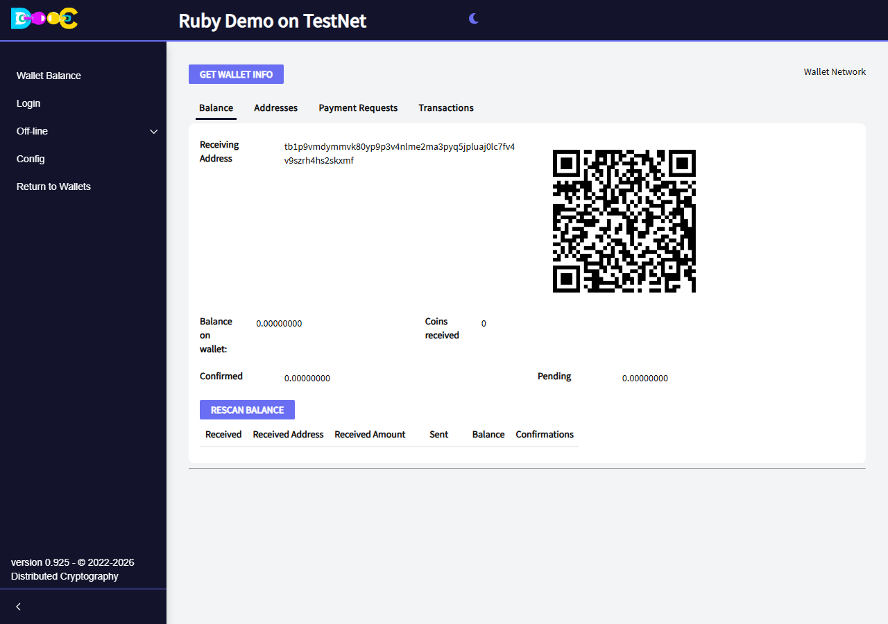

</Steps>

The receiving address, the **Addresses** tab, payment requests and **Get Wallet Info** work as in any wallet.
**Get Wallet Info** shows the account public key (`xpub…`, or `tpub…` on TestNet), which is all the application
gets from Ruby: the private keys never leave it.

To pay, see [Send a payment](/wallet/ruby/#send-a-payment).
