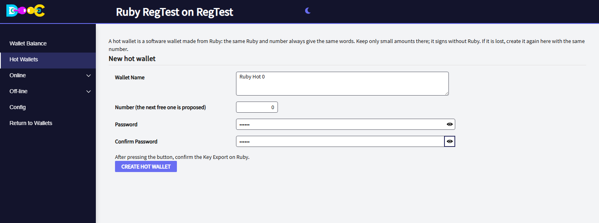
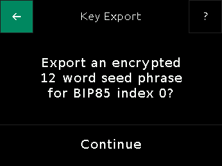
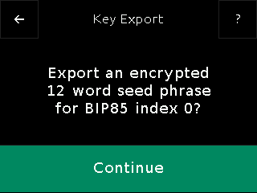
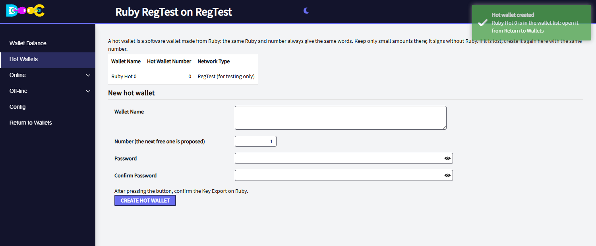
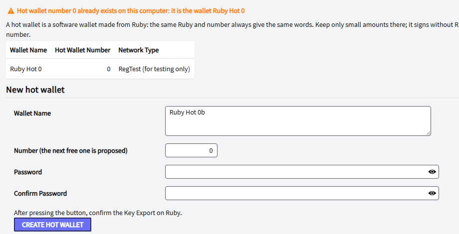
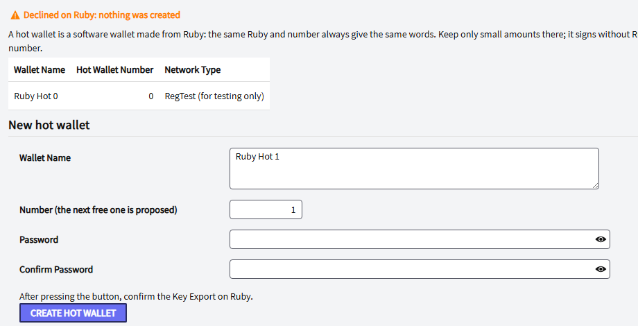
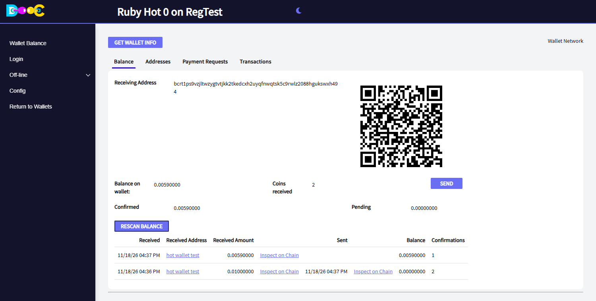
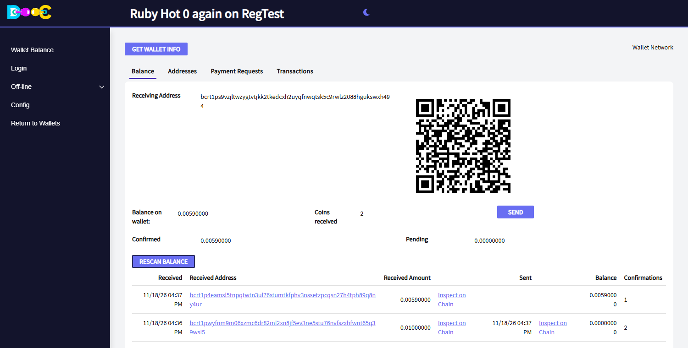

import { Steps } from '@astrojs/starlight/components';

:::note[Next release]
Hot wallets come with the next release of the application. The Ruby firmware needs no update.
:::

A **hot wallet** is an ordinary software wallet whose 12 words are made **by Ruby, from its own words**, with
[BIP85](https://github.com/bitcoin/bips/blob/master/bip-0085.mediawiki). Ruby keeps the savings; the hot wallet
holds small amounts for every day and signs on the computer, with its password, **without Ruby**.

A Ruby wallet can have many hot wallets. Each one has a **number** (0, 1, 2, …), and the same Ruby words with the
same number always give the same hot wallet.

| | |
|---|---|
| One backup | The words of your Ruby wallet bring back every hot wallet: see [A lost hot wallet](#a-lost-hot-wallet) |
| A stolen hot wallet | Does not expose Ruby: its words reveal neither Ruby's words nor the other hot wallets |
| Its words | Standard BIP39, 12 words, **no passphrase**: a normal Taproot (BIP86) wallet that other wallets can open too |
| Where it lives | A wallet file on this computer, protected by its own password, like any software wallet |

:::caution[Only small amounts]
A hot wallet signs on the computer: spyware on that computer could steal it, as it could steal any software wallet.
Keep the savings in the Ruby wallet and move to a hot wallet only what you plan to spend.
:::

## Create a hot wallet

You need the Ruby wallet open (its password, and the PIN on Ruby) and Ruby connected.

<Steps>

1. In the Ruby wallet open the menu **Hot Wallets**. It appears only in Ruby wallets. The page lists the hot wallets
   of this Ruby wallet **on this computer** and proposes the next free number.

2. Type a name for the hot wallet and its password (twice), and click **Create hot wallet**.

   

3. On Ruby, check the number: **Key Export**, *Export an encrypted 12 word seed phrase for BIP85 index 0?* The
   back arrow is selected first: press **C** twice to reach **Continue**, then **B**.

   | | |
   |---|---|
   |  | **Key Export** with the number of the hot wallet (*index 0*). **←** is selected first, on purpose. |
   |  | **C** twice moves to **Continue**, **B** confirms. |

   Ruby sends the words encrypted to the application, which keeps them only inside the new wallet file. They are
   never shown on the screen, and they never reach the browser.

4. *Hot wallet created*: it is in the list, and the next number is proposed.

   

</Steps>

If something is wrong nothing is created, and the page says why:

| | |
|---|---|
|  | **A number that already has a wallet on this computer** is refused before Ruby is asked. |
|  | **Declined on Ruby**: you pressed **←** on Ruby. |

If Ruby locked itself in the meantime, the page asks you to open the Ruby wallet again.

## Use the hot wallet

Click **Return to Wallets** and open the hot wallet with **its own** password. It is a normal software wallet, on the
same network as the Ruby wallet: receive, send and everything else work as in any wallet, and it signs with its
password. Ruby is not needed.

## A lost hot wallet

Lost the computer, deleted the wallet, forgot its password? Create it again from Ruby:

<Steps>

1. Open the Ruby wallet, menu **Hot Wallets**.

2. Type **the same number** (any name and a new password) and click **Create hot wallet**. Ruby gives the same
   words: the same addresses and the same funds.

3. Open the new hot wallet and click **Rescan Balance** once: it starts with an empty history.

   

</Steps>

If the old wallet is still on this computer, its number is refused: delete or rename that wallet folder first.

**Without the application** any BIP85 tool brings it back from the Ruby words: choose *BIP39*, *English*,
*12 words* and *index* = the number of the hot wallet. Then restore those 12 words as a Taproot (BIP86) wallet with
**no passphrase**. Remember that this types the words of your Ruby wallet into that tool: do it only on a device you
trust, and only as a last resort.

:::tip[Write the numbers down]
The Ruby words bring back every hot wallet, but only if you know its number. Next to the paper with the Ruby words,
note the numbers you use (they start at 0, one after the other).
:::

## Good to know

- **The password protects only the file.** A hot wallet has no passphrase: its 12 words alone are the wallet, and the
  password only protects the wallet file on this computer. (In the other software wallets of the application the
  backup is "the words + the original password".)
- **The hot wallet remembers its Ruby wallet.** Its file keeps the fingerprint of the Ruby wallet and its number, in
  clear: they are not secret. Whoever reads the wallets folder learns that the two belong together, nothing more.
- **Each export is confirmed on Ruby**, with its number. Nothing is created without it.
- For now a hot wallet always has 12 words, and 2FA cannot be added when it is created.

## Related

- [Ruby hardware key](/wallet/ruby/)
- [Your backup is the words](/wallet/ruby/#your-backup-is-the-words)
- [Restore a Ruby wallet](/wallet/ruby-restore/)
