import { Steps } from '@astrojs/starlight/components';

:::note
What Ruby is: [Ruby hardware key](/wallet/ruby/).
:::

Use this when Ruby is lost, broken or erased (three wrong PINs), or when the computer with the wallet file is lost.
The words are typed **on Ruby**, never in the application: they, and the master key, never touch the computer.

:::caution[Demo words]
The words in these pictures belong to a demo **TestNet** wallet and are public. Never use them, or any words you
have shown to anyone, for real funds.
:::

You need:

- A Ruby **not set up** (its home screen says *Uninitialized*): a new one, or your old one after a *Factory Reset*
  (power it on, press **B** while the logo shows, then *Factory Reset*).
- The paper with your words, in order.

## 1. Start a new Ruby wallet in the application

There is no separate "restore" for Ruby in the application: you create a new Ruby wallet and, on Ruby, you choose to
restore your words instead of creating new ones.

On the wallets page click **Create a new wallet**: a name, **the same network** as the old wallet, **Ruby hardware
key**, your Ruby in **Ruby device**, a password for the new wallet file, and **Create Wallet**. The page waits for
Ruby (up to 2 hours: typing the words takes a while).

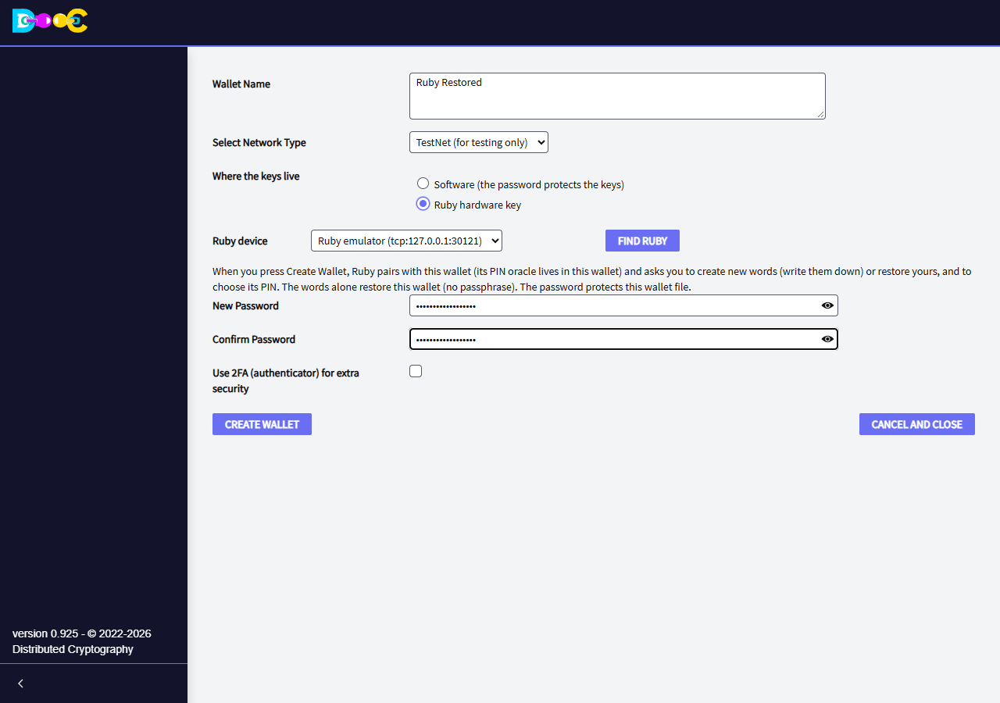

## 2. Restore the words on Ruby

On Ruby: **Continue** (B), **Begin Setup** (B), then:

| | |
|---|---|
| 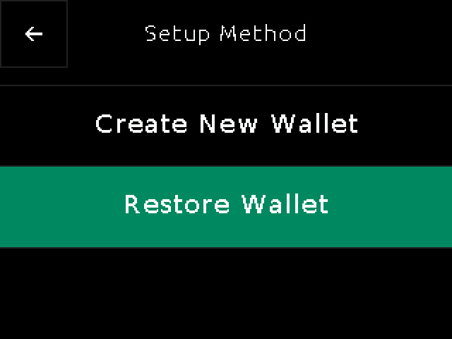 | Go to **Restore Wallet** (C) and select it (B). |
| 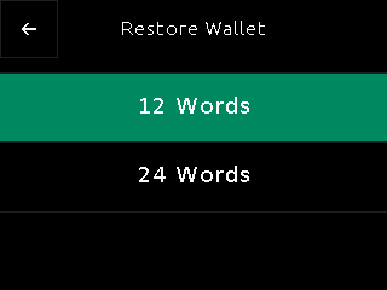 | **12 Words** (or 24, as on your paper). |

### Type each word

Each word is typed on a keyboard. **C** and **A** move the green selection over the letters, **B** types the
highlighted letter. Only the letters that can come next are enabled (blue frame); the others are skipped. The last
key (⌫) erases a letter.

| | |
|---|---|
| 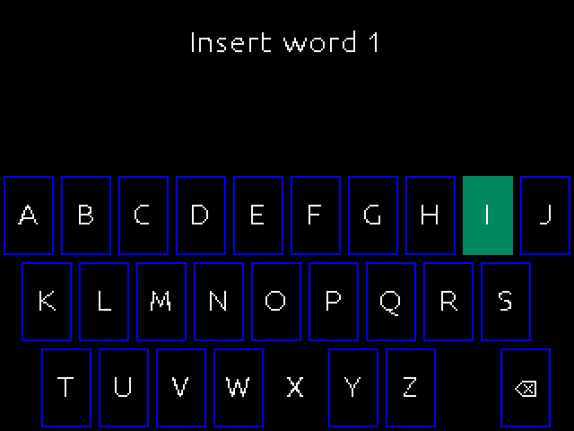 | **Insert word 1**: every letter that starts a word is enabled. |
| 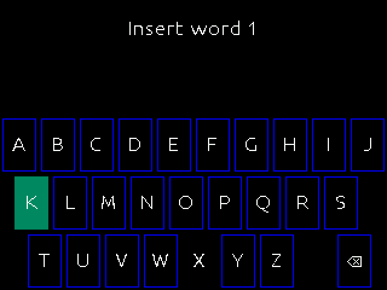 | Here the first word is *kitten*: move to **K** and press **B**. |
| 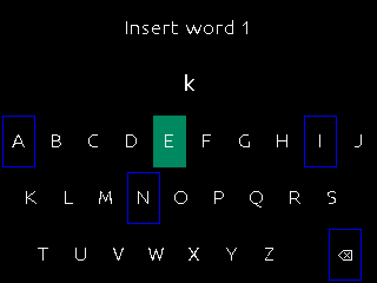 | After *k* only A, E, I and N remain. Type **I**, then **T**. |

As soon as 10 words or fewer match what you typed, Ruby lists them: **C** and **A** go through them (after the last
one comes ⌫, back to the keyboard), **B** chooses.

| | |
|---|---|
| 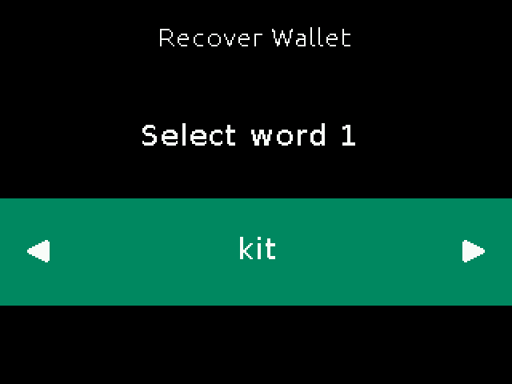 | After *kit*: *kit*, *kitchen*, *kite*, *kitten*. |
| 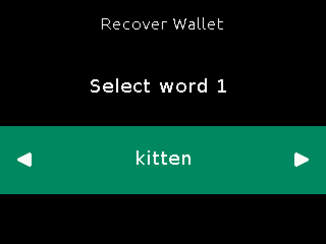 | Go to **kitten** and press **B**. Ruby goes on with **Insert word 2**. |

Repeat for every word. To fix a word already chosen, select ⌫ on an empty keyboard: Ruby goes back to the previous
word. At the end Ruby checks the words as a whole (the last word carries a checksum). If one is wrong it says
*Invalid recovery phrase* and starts again: check the paper and type them again.

### Choose the PIN

Choose the PIN twice, with the same wheels as when a wallet is created (see
[Choose the PIN](/wallet/ruby-create/#choose-the-pin)). It can be different from the old PIN: the PIN belongs to this
Ruby and this wallet file, not to the words.

| | |
|---|---|
| 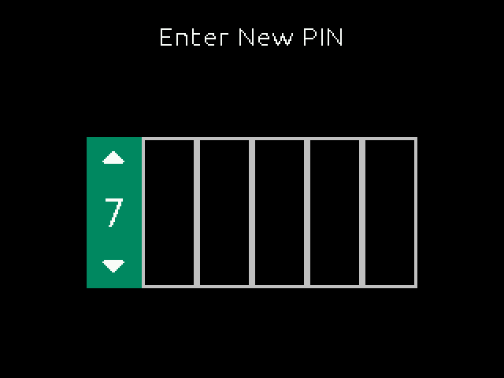 | After the last word: **Enter New PIN**, then **Confirm PIN**. |
| 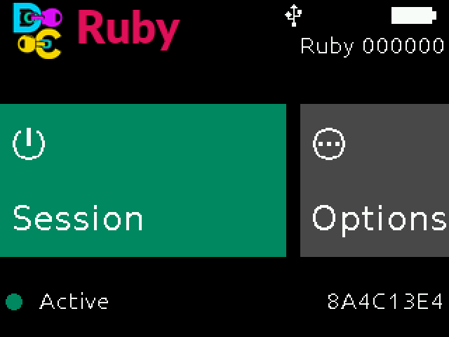 | Done: Ruby is **Active** and shows the fingerprint of the wallet, **the same as before**. |

The application finishes by itself and lists the new wallet.

## 3. Open the restored wallet

<Steps>

1. Open it as any Ruby wallet: the password, and the PIN on Ruby if it is locked. The receiving address is the old
   one.

   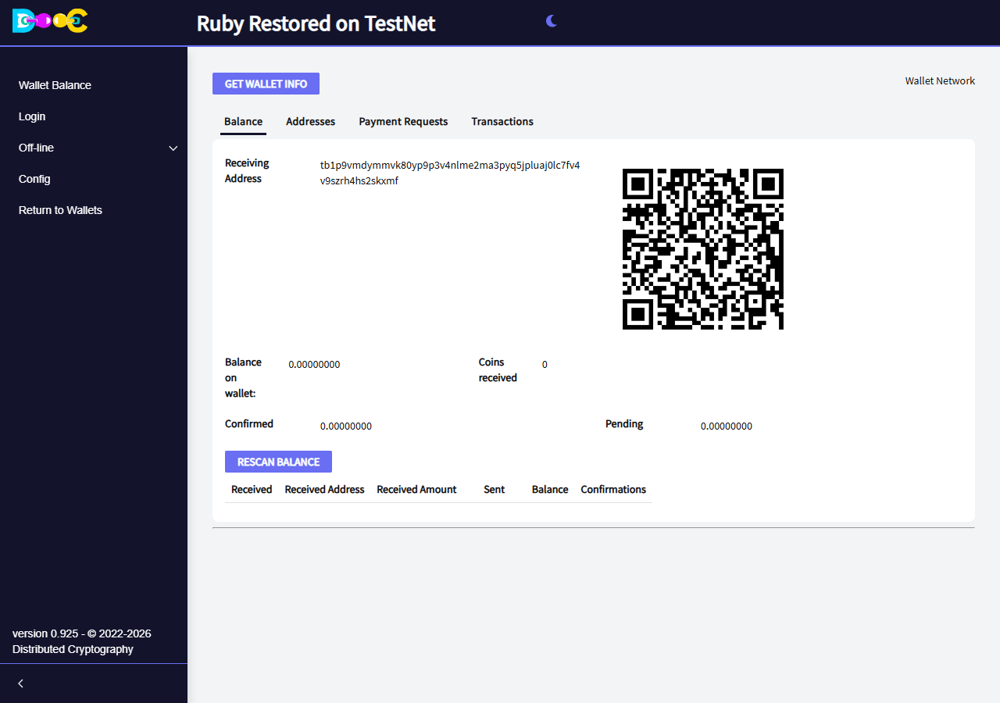

2. Click **Rescan Balance**: the balance, the history and the next addresses come back.

</Steps>

- The **old wallet file**, if you still have it, belongs to the old Ruby's oracle and cannot be opened with the new
  one. Delete it once the restored wallet shows your funds.
- The words bring back the bitcoin, not what was stored only in the old wallet folder (labels, payment requests,
  encrypted notes and files). [Log in](/online/) to get your contacts back from the server.

:::danger[Not in the application]
Do not restore a Ruby wallet with *Restore Wallet* in the application: that types the words into the computer,
where spyware can steal them. Only as a last resort (no Ruby at hand), and then move the funds to a new wallet: see
[Your backup is the words](/wallet/ruby/#your-backup-is-the-words).
:::
