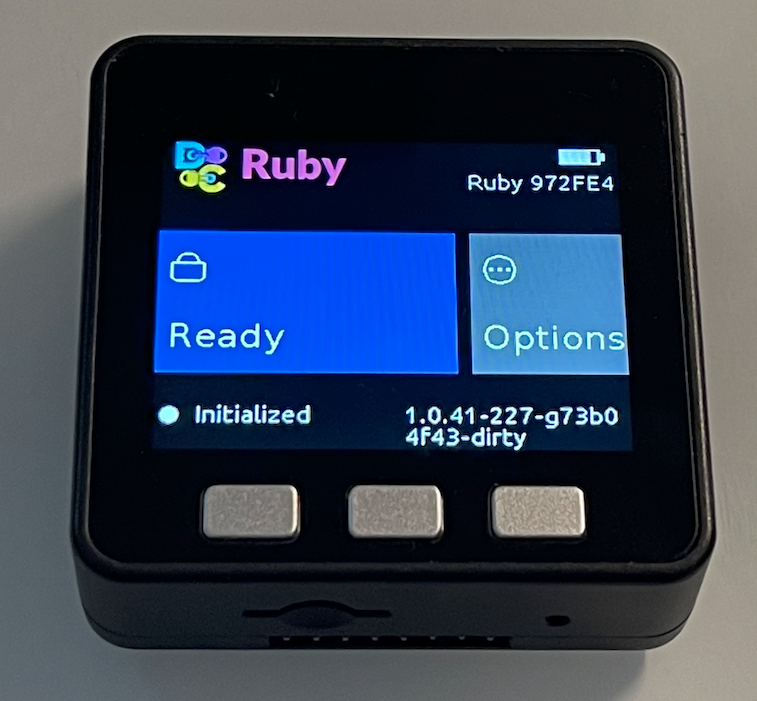

:::note
Ruby wallets come with version 0.926 of the application.
:::

**Ruby** is the hardware key of Distributed Cryptography: our own firmware, based on Blockstream's Jade and
**Bitcoin only**, running on a cheap generic ESP32 board. You do not need a Blockstream device (a retail Jade only
runs firmware signed by Blockstream, so it cannot run Ruby).

Ruby runs on the **M5Stack Basic**, a small development kit sold all over the world. It already has everything a
hardware key needs, in one case: the ESP32 processor (with the hardware for secure boot and flash encryption), a
colour screen to check what you sign, three buttons to confirm, USB, and a battery. No soldering and no extra parts.
And it is **extremely cheap**: about USD 40, a fraction of the price of a commercial hardware wallet.

A **Ruby wallet** is a normal wallet of the application whose words and spending keys live **on Ruby** instead of
in the wallet file on your computer.

- **Ruby creates the words and shows them only on its own screen.** You write them on paper; they are never typed
  into the computer.
- **Ruby signs every payment.** You check the amount, the address and the fee on Ruby's screen before you confirm.
- **Everything else works as in any wallet:** balance, addresses, payment requests, [anonymous login](/online/),
  contacts, chat and encrypted files. To open the wallet you type its password on the computer and the PIN on Ruby;
  after the PIN, Ruby gives the wallet the keys it needs for those features. Those keys cannot spend.
- **No outside server for the PIN.** Like Jade, Ruby protects its words with the PIN plus a secret kept by a
  "blind oracle". In a Ruby wallet that oracle lives **inside your wallet file**, not on a server: the oracle never
  sees the PIN or the words, and Ruby alone, without the wallet file and its password, is useless.

:::caution[Ruby is still for testing]
Today's Ruby firmware is a development build: it has no secure boot and no flash encryption yet. Malware on a
computer Ruby is plugged into could write other firmware to it. Until our signed firmware is out, use Ruby to learn
and to test, on TestNet or with small amounts.
:::

## What you need

- An **M5Stack Basic Core v2.7** (about USD 40), the one in the picture above. It is the board we test and
  recommend. Other ESP32 boards supported by Jade can run
  Ruby too, but we do not test each one.
- The **Ruby firmware** written to the board. Today it is built from its source code, published at
  [github.com/angelonardone/Ruby](https://github.com/angelonardone/Ruby) (branch `m5stack-basic`), and written to
  the board over USB with Espressif's `esptool`. A ready-made firmware and writing it from the application are
  planned.
- A **USB cable** between the board and the computer that runs Distributed Cryptography.

### Ruby's buttons

| Button | Position | Does |
|---|---|---|
| **A** | left | previous |
| **B** | middle | select / confirm |
| **C** | right | next |

After 90 seconds without use the screen dims; the first press only lights it again.

### Your computer

| | How Ruby shows up | Notes |
|---|---|---|
| **Windows** | a `COM` port (for example `COM4`) | — |
| **Linux** | `/dev/ttyACM0` or `/dev/ttyUSB0` | your user must be in the `dialout` group: `sudo usermod -aG dialout $USER`, then log out and in again |
| **Mac** | `/dev/cu.usbmodem…` (or `/dev/cu.wchusbserial…` with the WCH driver) | — |

The application looks for Ruby by itself; **Find Ruby** searches again if you plug it in later.

## How to

- [Create a wallet with Ruby](/wallet/ruby-create/), step by step.
- [Restore a Ruby wallet](/wallet/ruby-restore/) from its words, typed on a Ruby.

### Send a payment

Open the wallet, click **Send** and fill in the address, the amount and the fee as in any wallet. For a Ruby wallet
no password is asked: the button says **Send Coins (confirm on Ruby)**. Ruby shows the address, the amount and the fee: check them on Ruby's screen,
not on the computer, and confirm on Ruby. Ruby signs, and the application broadcasts the payment.

## Your backup is the words

A Ruby wallet uses **no passphrase**: the 12 (or 24) words **alone** are the wallet. The wallet password only
protects the wallet file on this computer.

:::caution[Different from a software wallet]
In a software wallet the backup is "the words + the original password". In a Ruby wallet the backup is **only the
words**; the password is not part of it.
:::

What happens if something is lost:

| Lost or stolen | What it means | What to do |
|---|---|---|
| Ruby alone | the thief cannot use it: it needs your wallet file and its password | [restore the words](/wallet/ruby-restore/) on a new Ruby |
| the computer, with the password | no words and no spending keys there (your messages and files, yes) | — |
| the computer and Ruby, with the password | the weak point of an oracle inside the wallet: whoever has all three can try PINs without limit | move the funds at once with your words |
| the computer (the wallet file) | Ruby stays locked: its oracle was in that file | reset Ruby, [restore the words](/wallet/ruby-restore/) on it |
| three wrong PINs | Ruby erases its key | [restore the words](/wallet/ruby-restore/) |

:::danger[Do not type the words into the computer]
The whole point of a hardware key is that the words, and with them the master key, never leave the device. To
restore, type them **on a Ruby**. *Restore Wallet* in the application (with the words and the original password
left **empty**) also gives back the same wallet, but as a software wallet: any spyware on that computer can steal
the words. Do it only as a last resort, and then move the funds to a new wallet.
:::

## The PIN oracle

When you type the PIN, Ruby asks the oracle inside your wallet file for its half of the secret. The oracle never
sees the PIN or the words, it counts the attempts, and after three wrong PINs it erases its record while Ruby erases
its key. Ruby pairs with the oracle of the wallet when the wallet is created, without asking anything.

On Ruby, *Options › Blind Oracle* should stay on **Use Wallet Oracle** (the default). *Use Remote Oracle* is for an
oracle server of your own, and Ruby accepts a new oracle only while it has no PIN: to pair a Ruby that already holds
a wallet with another one, reset it first.

## Other Ruby menus

Ruby keeps menus that come from Jade and that Distributed Cryptography wallets do not use: QR mode and the PIN
server over QR, SeedQR, BIP85 keys, one-time passwords (OTP), USB storage, temporary and duress wallets, the genuine
check and firmware upgrades, address and wallet scanning, and Bluetooth. They are not documented here yet and are
not tested with the application. On the M5Stack Basic the QR menus do not work at all (it has no camera), and
Bluetooth is off for now. Blockstream's [Jade documentation](https://help.blockstream.com/blockstream-jade)
describes what they do on a Jade.

## Not yet with Ruby

- **Smart Groups** (Consensus Backup, Delegated, Multi Signature, MuSig2, Legacy, Time-Encrypted Vault) cannot use a
  Ruby wallet yet: they need keys that only Ruby has.
- **Bluetooth:** Ruby works over USB only, for now.
