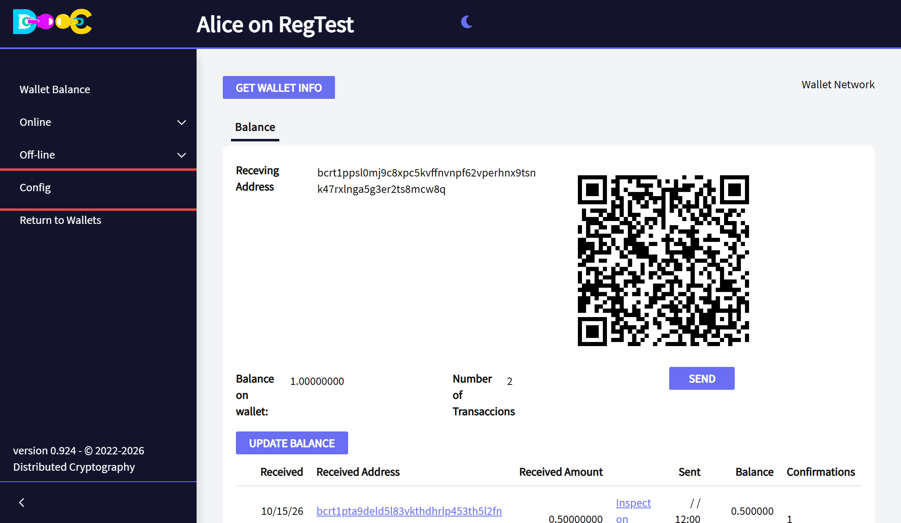
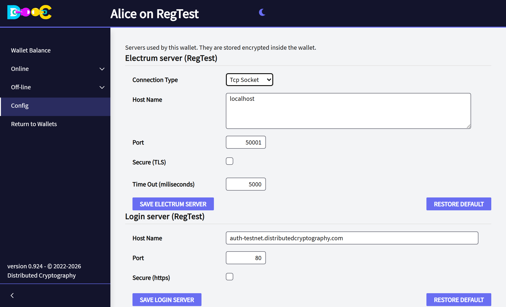

import { Steps } from '@astrojs/starlight/components';

A wallet talks to two servers:

- An **Electrum server**, to read the balance and the payments of your addresses and to send your payments to
  the bitcoin network.
- A **login server**, for the [online features](/online/): contacts, chat, sending files and Smart Groups.

A new wallet uses our servers for its network. You can change them in the menu **Config**.

- **Each wallet has its own servers.** Changing them in one wallet does not change the others.
- **Only the network of the wallet is shown.** A RegTest wallet only shows its RegTest servers.
- **The settings are stored encrypted inside the wallet**, with its other files, so only who opens the wallet can
  see or change them. They are host names and ports, nothing secret, and they are restored with the wallet's
  files when you [back up the Wallets folder](/install/#after-installing).

## Open the Config page

<Steps>

1. [Open the wallet](/wallet/create/#open-the-wallet).

2. Click **Config** in the menu on the left.

   

3. The page shows the Electrum server and the login server of the wallet.

   

</Steps>

## Electrum server

| Field | What to type |
| --- | --- |
| **Connection Type** | *Tcp Socket* for a normal Electrum server, *Web Socket* for a server that only accepts web sockets. |
| **Host Name** | The name or the IP address of the server, without `tcp://` or `https://`. |
| **Port** | The port of the server. Electrum servers often use 50001 without TLS and 50002 with TLS. |
| **Secure (TLS)** | Tick it when the server uses TLS on that port. |
| **Time Out (miliseconds)** | How long to wait for an answer. 5000 is 5 seconds. |

Click **Save Electrum server**. The wallet connects to the new server at once:

- When it connects, you see *Electrum server saved - Connected*.
- When it cannot connect, the server is saved anyway and the page tells you why it failed. Check the host name,
  the port and *Secure (TLS)*, or click **Restore default**.

:::tip[Your own Electrum server]
The Electrum server sees which addresses your wallet asks about (see
[What our servers can see](/security/privacy/)). If you run your own server (Electrs, Fulcrum or ElectrumX next
to your own bitcoin node), type it here and nobody else learns your addresses.
:::

## Login server

| Field | What to type |
| --- | --- |
| **Host Name** | The name of the login server, without `http://` or `https://`. |
| **Port** | The port of the server. |
| **Secure (https)** | Tick it when the server uses https on that port. |

Click **Save login server**.

- If you were logged in and the server changed, the wallet **logs you out**. The page tells you so. Click **Login**
  in the menu to log in to the new server.
- Your user on a server is your wallet's key, so logging in to another server makes you a new user there. Your
  contacts and groups stay on the server where you created them.

The login server only appears in wallets of the standard type (BIP86, Taproot), the ones that use the online
features.

## Go back to the default servers

Each section has a **Restore default** button. It saves our server for the network of the wallet:

| Network | Electrum server | Login server |
| --- | --- | --- |
| MainNet | `electrs-mainnet.distributedcryptography.com`, port 50100 | `auth.distributedcryptography.com` |
| TestNet | `electrs-testnet.distributedcryptography.com`, port 50100 | `auth-testnet.distributedcryptography.com` |
| RegTest | `localhost`, port 50001 (your own RegTest server) | `auth-testnet.distributedcryptography.com` |
